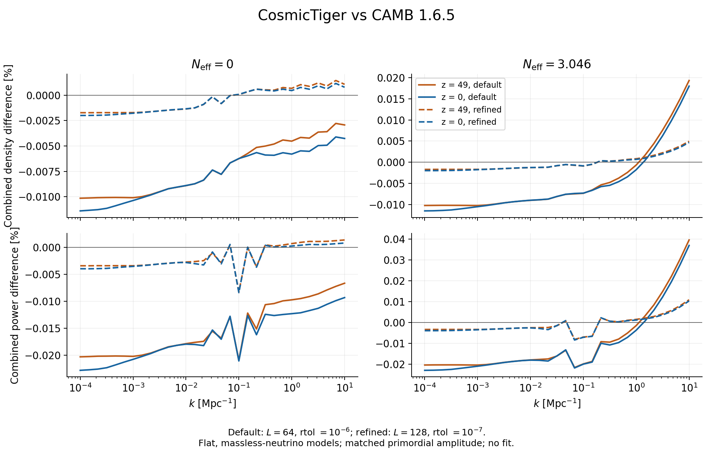

# Einstein–Boltzmann solver corrections and validation

The application now uses the
[native homogeneous chemistry model](native_recombination.md) for recombination.
Its separate [validation record](native_recombination_results_20261020/README.md)
covers the coupled native ionization and temperature history. The numbers
below preserve the preceding standalone-RECFAST-input baseline.

The native solver now reproduces CAMB 1.6.5's signed linear matter transfers
to **0.020%** and combined CDM+baryon power to **0.040%** in the tested
cosmology, using its default settings. These maxima cover 31 logarithmic
wavenumbers from \(10^{-4}\) to \(10\ {\rm Mpc}^{-1}\), redshifts 49 and 0,
and separate \(N_{\rm eff}=0\) and 3.046 calculations. There is no fitted
amplitude or sigma-eight normalization in this comparison.

This implementation fixes the issues identified in
[the October 20 audit](boltzmann_audit_20261020.md). **Massive neutrinos are
not implemented.** The existing massless-neutrino sector is retained,
corrected, and explicitly tested, including its absence when \(N_{\rm eff}=0\).

The complete reference settings, CSV results, convergence comparisons,
source and executable hashes, and reproduction commands are in
[the validation record](boltzmann_validation_results_20261020/README.md).

## Equations and conventions

The physical equations follow
[Ma & Bertschinger (1995)](https://arxiv.org/abs/astro-ph/9506072), in
synchronous gauge with CDM at rest. The independent coordinate is
\(x=\ln a\). In the following equations a prime means \(d/dx\), and
\(\mathcal H=aH\), \(\epsilon=k/\mathcal H\). Wavenumbers are in
\({\rm Mpc}^{-1}\), conformal time is in Mpc, and velocity variables are
\(v_s=\theta_s/k\). The quadrupoles obey \(F_{s2}=2\sigma_s\).

The returned signed transfers have initial \(\eta\to+1\), corresponding to
MB's \(C=1/2\). CAMB uses the opposite primordial sign; the comparison
explicitly reverses that sign rather than fitting a normalization.
Primordial tilt and amplitude are applied outside the ODE solver.

The metric uses MB (21a,b). Define
\[
 E=\epsilon^2\eta,\qquad
 D=\Omega_c\delta_c+\Omega_b\delta_b+
   \Omega_\gamma\delta_\gamma+\Omega_\nu\delta_\nu,\qquad
 f=\tfrac12(\Omega_c+\Omega_b)+2\Omega_\Lambda .
\]
Then
\[
 h'=2E+3D,\qquad
 E'=2(1-f)E+\epsilon^2\eta'.
\]
The scaled curvature \(E\) keeps the matrix well conditioned outside the
horizon. Directly putting an enormous normalized \(\eta\) into the implicit
matrix caused avoidable roundoff and rejected steps at small \(k\).

An additional metric variable independently integrates the trace equation
\[
 h_{\rm tr}''=-f h_{\rm tr}'-
 3(\Omega_c\delta_c+\Omega_b\delta_b)-
 6(\Omega_\gamma\delta_\gamma+\Omega_\nu\delta_\nu).
\]
The output `constraintResidual` compares this variable against
\(2E+3D\), normalized by the sum of absolute Hamiltonian terms.
It is not a residual set to zero by reconstructing both sides from the
same algebraic constraint. The trace approximation neglects the tiny
baryon pressure contribution to the Einstein source, consistent with the
nonrelativistic baryon continuity approximation.

Photon and baryon momentum are represented by
\[
 R=\frac{4\rho_\gamma}{3\rho_b},\quad
 w_b=\frac1{1+R},\quad w_\gamma=\frac R{1+R},\quad
 v=\frac{v_b+Rv_\gamma}{1+R},\quad s=v_b-v_\gamma .
\]
With \(S=a n_e\sigma_T/\mathcal H\), their equations are
\[
\begin{aligned}
 v'&=-w_bv+w_b c_b^2\epsilon\delta_b+
              w_\gamma\epsilon(\delta_\gamma/4-\sigma_\gamma),\\
 s'&=-v+c_b^2\epsilon\delta_b-
              \epsilon(\delta_\gamma/4-\sigma_\gamma)
              -[w_\gamma+(1+R)S]s .
\end{aligned}
\]
The time derivative \(R'=-R\) is included in this transformation.
The momentum equation for curvature is
\[
 \eta'=\frac{\tfrac32(\Omega_b+\tfrac43\Omega_\gamma)v+
                    2\Omega_\nu v_\nu}{\epsilon}.
\]
These variables avoid cancellation between enormous photon and baryon
drag coefficients in tight coupling. Transport and collisions are solved
together; there is no operator-splitting approximation to tight coupling.

The photon, polarization, and massless-neutrino interiors retain the MB
coefficients. The terminal moment now uses the MB free-streaming closure,
\[
 F_L'=\epsilon F_{L-1}
       -\frac{L+1}{\tau\mathcal H}F_L-SF_L ,
\]
where the last term applies only to photons/polarization. This corrects
the terminal streaming coefficient, the missing timestep in the implicit
photon damping, and the missing neutrino damping.

Initial perturbations use MB (96), including the corrected
\(F_{\nu2}=2\sigma_\nu\). The leading radiation-era series is adjusted once
to satisfy the Hamiltonian constraint at the finite initial matter fraction,
while retaining the specified primordial curvature. The metric subsequently
evolves independently; there is no recurring constraint projection.

## Numerical method

`solveBoltzmannTransfers` solves all requested, ordered output epochs in one
integration per wavenumber. Its default controls are relative tolerance
\(10^{-6}\), absolute tolerance \(10^{-10}\) on the internally scaled state,
maximum \(\Delta\ln a=0.1\), and maximum multipole 64. The ceiling is runtime
configurable; no 1024-moment array is evolved unconditionally.

The integrator is the three-stage, third-order, L-stable SDIRK method of
[Alexander (1977)](https://doi.org/10.1137/0714068). Each implicit stage
evaluates all background coefficients at its own stage time. The three
hierarchy tails are tridiagonal and eliminated into a 14-variable coupled
metric/fluid block. A pivoted solve handles that block.

Step doubling compares one full step with two half steps, divides their
difference by seven, and accepts the two-half-step result. There is no
Richardson extrapolation that could sacrifice the underlying method's
stability. Adaptive rejection and a step budget replace the previous fixed
oscillation/expansion heuristic. Invalid parameters, nonfinite states,
invalid background tables, and out-of-domain requests fail explicitly.

The error norm uses a floor equal to 1% of the largest metric/fluid density
amplitude before multiplying by the relative tolerance. This prevents
acoustic zeros and negligible radiation tails from dominating a
matter-transfer calculation. It does **not** promise the same relative
accuracy for every small radiation or baryon-relative-velocity component.

## Background and initial-condition fixes

Photon density now follows the configured CMB temperature:
\[
 \Omega_\gamma=\frac{4\sigma_{\rm SB}T_{\rm CMB}^4}{c^3\rho_{\rm crit}},
 \qquad
 \Omega_\nu=\Omega_\gamma N_{\rm eff}\frac78(4/11)^{4/3}.
\]
Setting \(N_{\rm eff}=0\) therefore removes neutrinos without transferring
their energy into photons. The native chemistry model receives the total
radiation density directly, so recombination and perturbations use the same
expansion history. The bundled RECFAST executable and its table import were
subsequently removed; archived comparison data remain available. Background
matter-density scaling, zero-component fractions,
thermal-stage timing, and physical input checks are corrected.

The internal particle initializer now:

- Combines signed CDM and baryon transfers before squaring, including their
  cross term. `sigma8` normalizes this combined matter spectrum at \(z=0\).
- Uses the density transfer at the requested initial redshift directly.
- Builds a separate velocity FFT from
  \(\delta_{cb}'=-h'/2-f_b\epsilon v_b\), with the same random phases as the
  density displacement. Stored particle velocity is
  \(a^2H_{\rm code}\,d\boldsymbol\Psi/d\ln a\).
- Uses validated interpolation tables covering the actual Fourier-grid
  corner, with explicit failures for malformed or insufficient external
  spectra.
- Waits for launched tasks before propagating their exceptions.
- Rejects nonflat cosmologies for this flat-background internal solver.

External power files retain the existing \(P(k,z=0)\) and approximate
scale-independent-growth convention. Both particle species still share the
combined matter displacement field. Second-order LPT retains the approximate
EdS kernel; the internal spectrum's already-applied growth factor is no
longer applied a second time.

## Validation and practical limits

The fiducial comparison uses \(h=0.6732\), \(\Omega_b=0.049389\),
\(\Omega_c=0.26503\), \(T_{\rm CMB}=2.7255\) K, and \(Y_{\rm He}=0.2454006\).
This baseline uses standalone RECFAST input for CosmicTiger and CAMB's RECFAST
model, with reionization disabled; CAMB's extra baryon
thermal and ionization perturbations are disabled. CAMB is run separately
through its Python package and files, and is not linked into CosmicTiger.

| Maximum difference from CAMB | Default | Refined: tolerance \(10^{-7}\), \(L=128\) |
| --- | ---: | ---: |
| Individual matter density transfers | 0.01960% | 0.005036% |
| Combined CDM+baryon power | 0.03958% | 0.01085% |
| Combined matter derivative used for IC velocities, sampled probes | 0.01922% | 0.004941% |
| Independently integrated Einstein trace, normalized residual | \(8.97\times10^{-7}\) | \(1.58\times10^{-7}\) |

The separate hierarchy test holds tolerance at \(10^{-7}\): increasing
\(L=64\) to 128 changes individual matter transfers by at most 0.01828%,
with the largest effect at \(k=10\ {\rm Mpc}^{-1}\). The separate timestep
test holds \(L=64\): tightening tolerance from \(10^{-6}\) to \(10^{-7}\)
changes individual transfers by at most 0.00952%. Doubling the initial scale
factor at fixed \(L=128\), tolerance \(10^{-8}\), and \(k=1,10\) changes
matter transfers by at most \(2.12\times10^{-7}\) relative.

All **13 focused CTests pass**, covering the adiabatic initial conditions, corrected
neutrino shear, small-\(k\) conditioning, numerical convergence, independent
metric consistency, invalid input, spectrum interpolation and normalization,
RECFAST, radiation options, and background thermodynamics. AddressSanitizer
and UndefinedBehaviorSanitizer checks pass; LeakSanitizer is disabled because
of the sandbox. CPU application smoke runs exercise internal power generation,
displacement/velocity FFTs, evolution and checkpoints. The initial snapshot's
512 velocities are finite and nonzero in all three components. Independent
integration of its saved spectrum gives \(\sigma_8=0.860700012\) for the
requested 0.8607. Logs and final source hashes are saved in
[application checks](boltzmann_validation_results_20261020/application_checks/manifest.json).

This is a validation of linear matter transfers in the stated models and
range. CMB spectra, tiny late-time radiation moments, massive neutrinos,
curved backgrounds, and arbitrary cosmological parameter surveys are outside
this validation. In the probes, the small late-time baryon-relative velocity
has a larger error, up to 1.22% at default settings, while the combined matter
growth rate used for particle velocities agrees much more closely.

The solver requires its background to begin with \(k\tau<0.05\) in radiation
domination. The current background start implies an upper usable \(k\) of
about \(32\ {\rm Mpc}^{-1}\) for the fiducial massless-neutrino model
(about \(25\ {\rm Mpc}^{-1}\) with no neutrinos). Requests above this fail
explicitly and need an earlier background start plus further convergence
validation. No GPU or MPI validation is claimed by these checks.
