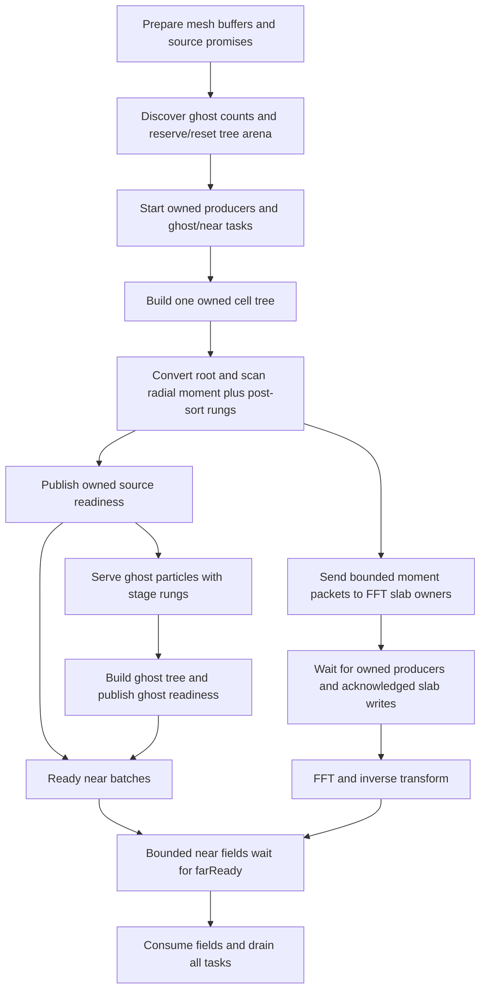

# Spherical mesh deposition from owned Cartesian roots

Part 3 of `spherical_fmm_tree_plan.md` reuses the completed owned cell kd-tree
as the source of the spherical FFT moments. The near walk uses that same tree.
Boundary long solves use the endpoint forest for both deposition and Cartesian
local descent. The immediately following opening short pass reuses those roots
without another sort or build. Frozen near-only passes retain their
no-deposition/no-FFT behavior. The standalone PP solver and direct spherical
particle deposition/evaluation paths are removed.

## Boundary arithmetic

Let r be a physical offset, y=κr the tree coordinate (κ=`kScaleFactor`), and
u=r/h the mesh coordinate. Let c be the actual stored tree root center and a
the mesh cell center. `treeSourceToMesh` first translates by κ(c-a), then
applies the pure source map from `fmm_basis_conversion.md`, then scales rank n:

\[
C_n^a=\operatorname{M2M}_{\kappa(c-a)}(C^c)_n,\qquad
S_{nm}=(\kappa h)^{-n}(-1)^n\sum_{|\alpha|=n}u_{nm\alpha}C_\alpha^a.
\]

Every dipole is retained. Center differences use native fixed-point integer
subtraction before conversion to double. Owned leaf P2M uses two-lane double
positions, mass weights, polynomial arithmetic and reduction. Owned M2M uses
the existing two-lane double arithmetic and retains its output in double.
Only the copy written to the persistent near-tree arena narrows to float.
Ghost tree construction retains the existing mixed leaf/float storage path.

The independent radial summary is still
\(Q_s=\sum_jm_j|u_j|^2\). It is accumulated in double about a during the scan
that snapshots post-sort rungs, after tree construction and before source
publication. That scan performs no harmonic P2M. The existing potential
constant correction consumes Qs in mesh coordinates, with its existing h²
factor. No source or local trace slot was added.

## Scheduling and failure handling

The coordinator completes ghost planning on all localities before any tree is
built. Owned producers and ghost/near tasks have separate future lists.
`deposit()` waits only for owned producers. Near consumers can wait for
`farReady` without becoming a dependency of deposition or the FFT.

Each producer handles disjoint cells, retains at most 32 converted cells,
groups them by FFT slab owner, and waits for all writes before forming its
next packet. A double Cartesian root lasts only through its conversion.
Production owned and ghost roots are not duplicated in the compatibility
distributed-root cache. Post-sort particle mappings and SPH reverse links
follow the existing cell-tree construction contract.

On failure, owned-source promises receive either a root or an exception.
All started source producers and slab writes drain; abort releases far-field
waiters; ghost and near tasks drain before arena and source-state cleanup.
Ghost count futures also drain before propagating a planning failure.

## Transient precision and memory

`TreeBuildMoments` contains one active float or double alternative. Explicit
serialization sends its precision tag and only the active-order coefficients;
it does not transmit the variant's entire storage. Ghost returns and cached
compatibility roots serialize float coefficients. Persistent positioned tree
records, remote walk records, ghost particle packets and walk locals retain
their previous layouts.

In the configured order-7 build:

| Item | Bytes |
|---|---:|
| Float multipole coefficients (persistent) | 144 |
| Double source coefficients (transient) | 288 |
| Complete transient tree build return | 368 |
| Serialized float moment buffer, including archive overhead | 170 |
| Serialized double moment buffer, including archive overhead | 314 |

Double upward results live in recursive returns/futures, rather than a second
persistent tree. Children are discarded when their parent is reduced. The
additional coefficient storage per live owned result is one float buffer's
size (144 bytes at order 7), plus the variant tag/padding. The number of live
results depends on the recursive fork frontier; it is bounded by the number
of constructed nodes. Root conversion needs a constant number of temporary
order-sized buffers. Converted packet coefficients are bounded by
32 × worker-count × source-count × sizeof(double), plus packet metadata and
the acknowledged HPX transport copy. There is no extra per-particle result
array or retained double root array.

## Verification

`tests/gravity/tree_source_moments.cpp` compiles the actual source arithmetic
and transport for both fixed32 and fixed64, independently of the application's
configured width and order. It covers q=3..9, unequal masses, partial SIMD
packets, child-to-parent translation, root recentering and four mesh widths.
A native-position fixture uses centers separated by a few fixed-point units
near the periodic boundary; in fixed64 these differences are below double's
absolute-coordinate resolution. The oracle is direct spherical double P2M.

The application PMMM regression additionally compares every actual deposited
slab coefficient and radial summary with the pre-refactor direct double cell
scan. Empty slabs, dense/sparse populations, changing ownership and repeated
solves exercise routing and cleanup. An observer verifies one owned root and
one deposition per occupied cell, injects a publication failure, and checks
that the following solve reproduces the reference. Existing stage, signed-kick,
near/far, finite-expansion and Ewald tests remain in place.

Precision experiments reconstruct the same kd-tree arithmetic with float
upward records, double upward records with mixed leaves, mixed leaves widened
before horizontal reduction, and full-double leaves. These are test helpers,
not runtime deposition options. Full double is the production baseline so the
existing direct double coefficient envelope is retained.

Validation on November 9, 2026:

- Both width-specific source tests pass 1,421 checks each, across q=3..9.
  Worst rank-scaled discrepancy is 3.22e-14 (fixed32), 5.43e-14 (fixed64).
- The Release order-7 application builds. The full PMMM and focused source
  regressions pass with one, two and four localities. This includes exact slab
  coefficients, mass, empty localities, sparse/dense cells, changing ownership,
  staged rungs, potential switches, repeated solves, failure recovery and the
  deterministic delayed-ghost overlap gate. Two-locality runs use two HPX
  workers per locality; four-locality runs use one. MPI runs were confined to
  two logical CPU affinities overall, with no concurrent builds.
- CPU PP fallback, evolution/restart and frozen-interval regressions pass.
- NVCC sm_86 compilation of the production tree/positioned-moment interface
  passes for both fixed32 and fixed64. No GPU kernels were executed. The full
  application's fixed64 runtime and CUDA runtime were not tested here.
- Formatting and whitespace checks pass. No sanitizer, hosted-CI or complete
  application test-suite claim is made.

The distributed regression exposed an existing fixture error: it disabled
gravity to migrate every rung, which also disabled coarse-aligned domain
cuts. The saved pre-change executable failed the same first field comparison.
The fixture now keeps gravity enabled and calls the existing `domainsBegin(-1)`
all-rung migration mode. With this correction, the complete distributed field
suite passes as well as the new source tests. Production domain code did not
need to change.

Maximum errors for the single-locality, 320-particle dense fixtures at mesh
sides 4, 8 and 16, order 7:

| Upward arithmetic/storage | Rank-scaled coefficient error | Propagated field error |
|---|---:|---:|
| Existing mixed leaves, float upward records | 6.32e-9 | 1.46e-9 |
| Existing mixed leaves, double upward records | 3.24e-10 | 1.34e-10 |
| Float point arithmetic, widen before horizontal reduction, double upward | 1.84e-10 | 4.75e-11 |
| Full-double leaves and upward records | 6.25e-15 | 2.46e-16 |

Coefficient errors are normalized by cell mass × (1/2)^n/n!. Field errors use
max(1, |reference component|); the test propagates the coefficients through a
periodic harmonic Green contraction and local evaluation. These are source
precision comparisons against direct double P2M, before the production float
FFT. Widening the horizontal reduction alone does not restore the double
coefficient envelope. Full double is retained as the baseline; there is no
runtime precision selector.

## Whole-solve timing

[fmm_root_deposition_benchmark.json](fmm_root_deposition_benchmark.json) records
three alternating baseline/new runs with 32,768 Plummer particles, order 7,
mesh side 16, width 2, two traditional PMMM kicks, two HPX workers and a shared
two-logical-CPU affinity mask. The baseline is the saved executable immediately
before Part 3. Both use Release optimization, CPU near interactions and no GPU.

| Measurement (median of three runs) | Before | Root reuse |
|---|---:|---:|
| Application elapsed time | 8.090 s | 8.078 s |
| Sum of reported PMMM coordinator phases, two solves | 7.48 s | 7.47 s |
| APEX `buildCellTree` interval totals | 21.785 ms | 26.218 ms |
| APEX owned-producer interval totals | 1.943 ms | 3.902 ms |
| APEX direct spherical deposition interval totals | 5.176 ms | absent |

APEX intervals overlap/nest and must not be added to the coordinator totals.
Coordinator rows have 0.01-second reporting resolution. New deposition wait
time (0.02 s for two solves) includes owned tree completion; previously the
tree built asynchronously after direct deposition and overlapped the FFT.
Application ranges were 8.076–8.137 s before and 8.028–8.087 s afterward.
This small, near-work-dominated experiment demonstrates essentially unchanged
whole-solve time, not a measured speedup. Full-double construction is more
expensive, while redundant spherical particle P2M disappears.

Raw CPU, MPI and benchmark logs are retained for this session under
`/tmp/cosmictiger_root_deposition_validation/`.
