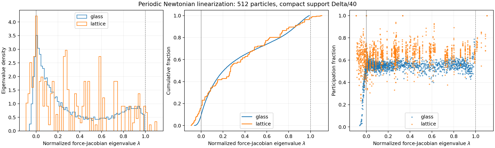
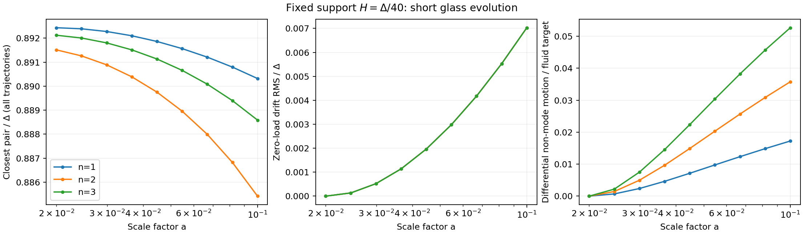
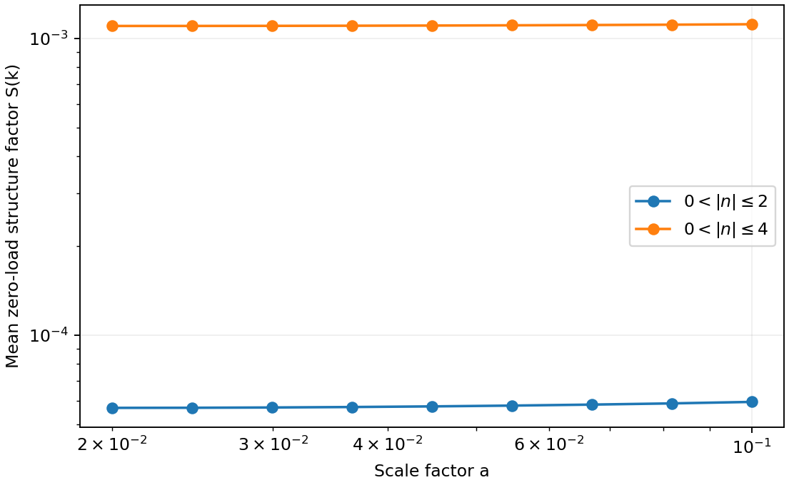
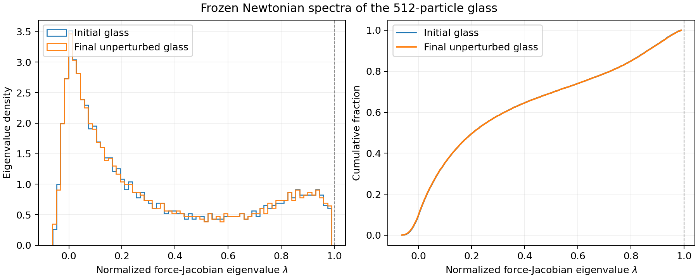

# Small fixed comoving softening on the saved glass

This diagnostic tests fixed compact-support gravity at `H=Delta/40`, where
`Delta=L/8` is the mean spacing of the saved 512-particle, one-class glass.
The density kernel is Ferrers F2, `(1-q^2)^2`, with `q=r/H`. The configured
support is `H=0.003125 L`; the effective radius `2 sigma` is `2H/3`, or
`Delta/60`. These are compact support and effective radii, not a Plummer
softening convention.

The full-particle spectra at the initial load and final unperturbed load
contain **no glass mode that grows faster than the pressure-free continuum
mode**. In the short evolution to `a=0.1`,
the smallest pair separation at saved times remains `35.42 H`, with no close
pair formation. The sampled perturbations grow more slowly than their fluid
targets. This supports the absence of an early gravitational collapse
instability for this load and interval. It does not certify long-term
collisionless accuracy, the production block-timestep integrator, or gas
stability with SPH pressure.

## The support is initially smaller than every separation

The nearest pair in the saved glass is separated by `0.89248023 Delta`, or
`35.6992 H`. The compact kernel is exactly Newtonian outside its support, so
no initial pair feels softened gravity. Reducing the support further cannot
change the exact initial force or its Jacobian until particles enter that
support. A doubled-support `H=Delta/20` control also remains far below every
initial separation. In that completed control, the entire production CSV of
initial particle positions and acceleration components is byte-identical to
the `H=Delta/40` output.

The glass was generated using fixed F2 support `0.02815483 Delta`, also well
below its final nearest-particle separation. It therefore already experienced
the same exterior Newtonian force law at its saved final configuration. The
previous warning about a changed force law concerned the broad *adaptive*
supports used in the earlier tests. It does not imply that this slightly
smaller fixed support requires generating another glass.

The generator stopped on a relative potential-energy change of `6.57e-6`,
not a zero-force tolerance. Its force calculation used opening angle `0.4`
(the driver overrides the initial configuration's `0.8`). The glass therefore
still has a measurable residual force and must be treated as a drifting load.

## Full particle-space spectrum

The independent calculation assembles the periodic Newtonian Ewald Hessian
for all 512 particles and diagonalizes the complete `1536 by 1536` response
matrix. For equal masses, normalize the acceleration Jacobian as

\[
J=\frac{1}{4\pi G\bar\rho_{\rm com}}
\frac{\partial\boldsymbol g}{\partial\boldsymbol x}.
\]

There is no assumption that a glass Fourier wave is an eigenmode. In the
matter-dominated approximation, an eigenvalue `lambda` has growing exponent

\[
p_+=\frac{\sqrt{1+24\lambda}-1}{4},\qquad D\propto a^{p_+}.
\]

The continuum longitudinal value is `lambda=1`, giving `p_+=1`. Positive
eigenvalues represent ordinary pressure-free gravitational growth, so their
presence alone does not diagnose a numerical instability. Eigenvalues above
one would identify initial growth faster than that continuum benchmark.
Negative eigenvalues represent restoring directions, with damped oscillations
when sufficiently negative; they do not represent fast gravitational collapse.

| Initial frozen-load measurement | Glass | Cubic lattice |
| --- | ---: | ---: |
| Minimum eigenvalue | -0.06133070 | -0.09269082 |
| Maximum eigenvalue | 0.98891992 | 1.10423556 |
| Eigenvalues above 1 | 0 | 33 |
| Negative eigenvalues | 145 | 279 |
| Translation zero modes | 3 | 3 |
| Fastest EdS growing exponent | 0.99333418 | 1.06105047 |
| Effective particles participating in fastest mode | 380.19 | 512.00 |

For an eigenvector normalized by `sum_i |e_i|^2=1`, the participation count is
`1/sum_i |e_i|^4`, grouping the three coordinates of each particle together.
The fastest glass mode is distributed over hundreds of particles, rather
than concentrated in a close pair. No initially faster-than-continuum mode
was found anywhere in the full glass spectrum, including modes not sampled
by the sinusoidal tests.
The lattice participation count describes the returned eigenvector basis;
within a degenerate eigenspace that count can change under basis rotations.

The independent force RMS is `0.007290428241` in units with `G rho_comoving=1`
and `L=1`; the lattice force vanishes to approximately roundoff. Matrix
symmetry and the three translation modes pass to about machine precision.
The trace is `N-1=511`. Changing the Ewald partition and cutoffs changes the
normalized matrix by less than `2.5e-14` in Frobenius norm. Central force
differences at `1e-5 Delta` reproduce its action to better than `5.4e-10`
relative error. These checks establish the independent matrix calculation;
comparison to production forces is a separate check. The production initial
force agrees with the independent Ewald force to `1.50e-4` in relative vector
RMS; its measured force RMS is `0.007290426639`.

The production central-difference response was also checked against the
independent matrix acting on the actual realized particle displacements.
The longitudinal projected coefficients below differ by at most `3.2e-6`
in absolute value. The largest *full vector* relative discrepancy is `0.310%`,
in a weak transverse response. Exact Ewald forces for the positive and negative
configurations giving the worst discrepancy at each amplitude identify this
discrepancy as production force accuracy rather than a failure of linearization;
these selected finite-amplitude Ewald
responses differ from their linear matrix predictions by less than `4.1e-6`
relative. The saved comparison tables retain both measures.



## Sinusoidal force response

At initial displacement amplitude `0.001 Delta`, the projected longitudinal
force coefficient is much nearer the continuum value of one than in the
earlier broad adaptive F2/24 experiment:

| Wavevector | `k/k_Ny` | Fixed `H=Delta/40` | Earlier adaptive F2/24 |
| --- | ---: | ---: | ---: |
| `(1,0,0)` | 0.25 | 0.981138 | 0.955368 |
| `(2,0,0)` | 0.50 | 0.927146 | 0.809556 |
| `(3,0,0)` | 0.75 | 0.830760 | 0.526003 |

These coefficients are Fourier projections of the force response, not
eigenvalues of the glass particle matrix. The fixed-support production test
uses the CPU gravity path; the earlier adaptive results used the CUDA path
and a larger perturbation amplitude, so the table is a comparison of their
resolved responses rather than a force-backend equivalence test.

The six sampled directions with `|n|=3` have coefficients from `0.830760`
to `0.844051`. Halving the force-test amplitude from `0.002 Delta` to
`0.001 Delta` changes the projected response matrices by at most `1.61e-5`
relative. Some particle-scale response remains outside the fitted sine and
cosine mode even with such small softening: the x-axis longitudinal tests
have residual force RMS of `2.74%`, `5.72%`, and `8.65%` of the imposed
continuum response amplitude. Compact softening no longer suppresses the
initial pair forces, but the discrete glass still differs from a continuum.

## Short evolution and particle-level checks

The bounded experiment evolves the same glass from `a=0.02` to `0.1`, with
three x-axis modes and initial amplitude `0.001 Delta`. Each mode is evolved
with positive, negative, and zero perturbations. Production gravity is
recomputed at every RK4 stage; the experiment does not invoke the normal
cosmological run driver. A shortest-mode run with 16 steps and a separate
half-amplitude run test time and amplitude sensitivity.

Saved particle records retain identities, actual periodic fixed32 coordinates,
unwrapped displacement, realized displacement, and the derivative of
displacement with respect to `ln(a)`. The analysis checks every particle and
trajectory sample, reconstructs the original sine/cosine projections and
Eulerian Fourier densities, and rejects incomplete or inconsistent records.
Velocity diagnostics are displacement derivatives, rather than stored momentum;
at a fixed epoch their ratios equal the corresponding momentum ratios.

The periodic nearest-neighbor check records the minimum separation and counts
distinct pairs with separations below `H`, `0.1 Delta`, and `0.5 Delta`. It
includes all positive, negative, and zero trajectories, so a close pair cannot
be hidden by paired subtraction. A full particle field comparison also
measures differential motion relative to the sampled continuum displacement
and velocity fields. The zero trajectory measures common glass drift and
noise independently of the imposed perturbations.
These separation checks apply to saved output times, not every RK4 substage.

The nominal run contains all `41,472` requested particle records, covering
three modes, nine saved epochs, three trajectories, and 512 particles.
Every record passes the identity, initial-condition, projection, and density
reconstruction checks. Across all these samples, the smallest separation is
`0.88541758 Delta = 35.4167 H`. There are zero pairs below any of the three
thresholds. The unperturbed glass drifts by `0.00702891 Delta` RMS and
`0.0168052 Delta` maximum by the final epoch.

The continuum target uses the runtime expansion background, with growth
`D(0.1)/D(0.02)=4.95883623`; it is applied to the original initial perturbation.
The measured final responses are:

| `k/k_Ny` | Density / fluid target | Projected velocity / fluid target | Non-mode displacement RMS / fluid sine amplitude |
| --- | ---: | ---: | ---: |
| 0.25 | 0.986560 | 0.975967 | 0.017243 |
| 0.50 | 0.948946 | 0.909358 | 0.035772 |
| 0.75 | 0.883770 | 0.796585 | 0.052669 |

Density is the in-phase part of the paired Eulerian Fourier amplitude.
Velocity is the longitudinal sine projection of `du/dln(a)` on the initial
glass coordinates, normalized by the continuum growing rate at the final
epoch. The largest density quadrature is `0.002657` of its continuum target.
The full displacement-field RMS errors relative to the continuum sampled
field are `2.78%`, `7.19%`, and `13.81%`; these include both growth suppression
and motion outside the original mode. Small fixed support improves the
force response but does not eliminate particle discreteness errors.

The shortest-mode controls bound the measured numerical sensitivities:

| Control | Relative change in final density ratio | Relative change in projected velocity ratio |
| --- | ---: | ---: |
| 16 rather than 8 RK4 steps | +0.001042% | +0.001088% |
| Half the initial amplitude | +0.000777% | +0.000003% |

The half-amplitude density quadrature shifts by `1.71e-6` of the continuum
target. The 16-step baseline drift changes by `8.71e-9 Delta` RMS, and its
mean `|n|<=4` noise power changes by `1.03e-7` relative. Neither control
produces a close pair at its saved epochs. These are measured sensitivities
at the shortest tested wavelength, rather than a universal error bound for
all loads or later nonlinear evolution.



The zero-load structure factor is

\[
S(\boldsymbol k,a)=\frac{1}{N}\left|
\sum_j e^{-i\boldsymbol k\cdot\boldsymbol x_{j,0}(a)}\right|^2.
\]

All independent integer modes with `0<|n|<=4` are retained, with mean summaries
for `|n|<=2` and `|n|<=4`. Conjugate wavevectors are counted once. Growth of
this pre-existing load noise is distinct from the paired response to an
intentional mode; neither measurement alone establishes later nonlinear
fragmentation or two-body relaxation.

By `a=0.1`, the mean zero-load power increases by `4.737%` for `|n|<=2`
and `1.354%` for `|n|<=4`. The corresponding final means are `5.94577e-5`
and `0.00111790`. This modest noise evolution accompanies the measured small
baseline drift; it is not explosive small-scale growth.



The independent full matrix was recomputed on the final unperturbed glass.
Its largest eigenvalue is `0.98912815`, versus `0.98891992` initially, and
again none exceeds one. The fastest mode has a participation count of
`379.50` particles, versus `380.19` initially. The final zero-load nearest
pair is separated by `35.6221 H`; its force RMS is `0.00771378`. All three
independently repeated zero trajectories have identical final coordinates.
No fast localized collapse mode appears in either frozen spectrum. These
are two endpoint matrices, not a calculation of the entire time-dependent
linear propagator.



## What this does and does not decide

A small fixed support is not automatically an unstable initial force law.
For this compact kernel and saved load, all initial interactions are Newtonian,
and the complete initial spectrum has no overgrowing glass mode. The nonzero
baseline force means that its Jacobian will change as the load moves. Local
spectra and a short evolution cannot certify arbitrarily late behavior,
encounters after nonlinear collapse, or production timestep accuracy.

These are gravity-only, pressure-free tests. They do not answer the distinct
question raised by [Ploeckinger et al. (2024)](https://academic.oup.com/mnras/article/528/2/2930/7492291)
about gravity acting below the hydrodynamic pressure resolution. That question
requires SPH pressure, its independent smoothing solve, and a gas perturbation
that is stable according to the appropriate continuum Jeans dispersion
relation. A gas-only test with `c_s^2 k^2 > 4 pi G rho` in a static local
background provides a clean control. In a gas-plus-cold-dark-matter mixture,
the physical dark-matter growing branch makes a positive coupled eigenvalue
an insufficient instability criterion.

The need to use the full glass response, instead of identifying a Fourier
wave with a numerical eigenmode, is also discussed by
[Garrison et al. (2016), section 5.5](https://arxiv.org/html/1605.02333v3#S5.SS5).
The independent spectrum and short particle evolution test different aspects
of that response; neither substitutes for a resolved hydrodynamic Jeans test.

## Reproduction

The [artifact directory](glass_fixed_softening_results/) retains the exact
glass, commands, raw production outputs, independent spectrum, and analyses.
The production runner uses one locality and two or four HPX threads, while the
offline Python calculations use one BLAS thread. It refuses to overwrite
existing case directories.

The nominal evolution wrote its complete output and completion marker, but
the enclosing command session ended with signal-derived status `143` before
the wrapper captured the child's exit status. The child exit status is
therefore recorded as unknown. The analysis succeeds on the complete saved
data; this is distinct from claiming an observed successful process exit.
The interrupted first attempt at the 16-step control is also preserved and
is not used for its control comparison. The fresh 16-step control,
half-amplitude control, initial-force case, sinusoidal-force case, and
doubled-radius case all have captured zero exit statuses. The offline
analyzer passes six synthetic checks, and all 32 analysis CSV/JSON
artifacts reproduce byte-for-byte in an independent output directory. The
focused `linear_growth_response` CTest passes in 139.54 seconds. The release
build passes; the full repository test suite was not rerun.

```sh
GLASS_FIXED_WORK_DIR="$PWD/build/release/tests/glass_fixed_reproduction"
GLASS_FIXED_ANALYSIS_DIR="$GLASS_FIXED_WORK_DIR/analysis"
python3 -B docs/glass_fixed_softening_results/run_experiment.py initial_glass \
  --work-root "$GLASS_FIXED_WORK_DIR"
python3 -B docs/glass_fixed_softening_results/run_experiment.py response_glass \
  --work-root "$GLASS_FIXED_WORK_DIR"
python3 -B docs/glass_fixed_softening_results/run_experiment.py evolution_glass \
  --work-root "$GLASS_FIXED_WORK_DIR"

OPENBLAS_NUM_THREADS=1 python3 -B tests/analyze_glass_fixed_evolution.py initial \
  "$GLASS_FIXED_WORK_DIR/initial_glass" docs/glass_fixed_softening_results/glass.txt \
  "$GLASS_FIXED_ANALYSIS_DIR/initial_glass"

OPENBLAS_NUM_THREADS=1 python3 -B tests/analyze_glass_growth.py response \
  "$GLASS_FIXED_WORK_DIR/response_glass/linear_growth_response.csv" \
  "$GLASS_FIXED_WORK_DIR/response_glass/linear_growth_metadata.json" \
  "$GLASS_FIXED_ANALYSIS_DIR/response_glass"

OPENBLAS_NUM_THREADS=1 python3 -B tests/analyze_glass_fixed_evolution.py evolution \
  "$GLASS_FIXED_WORK_DIR/evolution_glass" docs/glass_fixed_softening_results/requests_8.csv \
  docs/glass_fixed_softening_results/glass.txt \
  "$GLASS_FIXED_ANALYSIS_DIR/evolution_glass"

OPENBLAS_NUM_THREADS=1 python3 -B tests/analyze_glass_fixed_evolution.py self-check
```

Run `control_16`, `control_half`, and `radius_control` through the saved runner
in the same new work directory. Analyze the two evolution controls using
their corresponding `requests_16.csv` and `requests_half.csv` files, with
output subdirectories `analysis/control_16` and `analysis/control_half`.
Analyze the radius control using `initial`. Then assemble the control summary:

```sh
OPENBLAS_NUM_THREADS=1 python3 -B tests/analyze_glass_fixed_evolution.py compare \
  "$GLASS_FIXED_WORK_DIR" "$GLASS_FIXED_ANALYSIS_DIR"
```

The independent Ewald spectrum script and command are retained with its
results. No production defaults are changed by these diagnostics.
