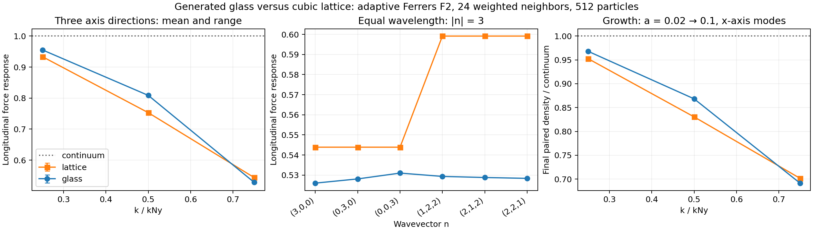
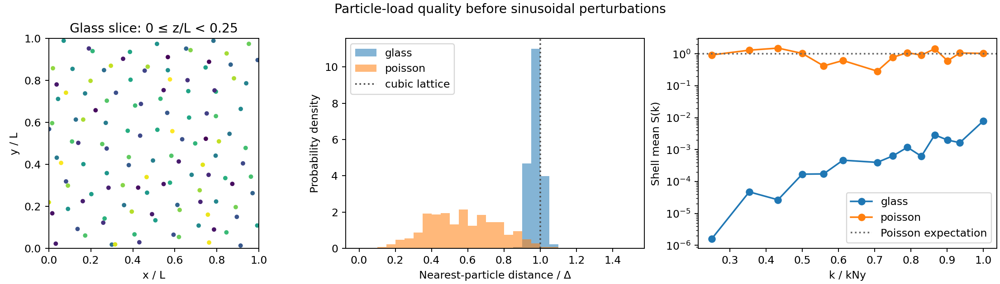

# Linear growth from a generated glass

This experiment compares a generated, disordered particle load with the cubic
lattice in the existing `linearGrowth` diagnostic. It uses one class of 512
equal-mass dark-matter particles, periodic boundaries, and the same default
adaptive gravity in both loads: Ferrers F2, `(1-q^2)^2`, 24 weighted neighbors,
with the adaptive conservation terms. It does not change production IC defaults.

The one-class test isolates particle arrangement. It does not establish the
behavior of a gas/dark-matter split with different class masses, hydro pressure,
or a full cosmological transfer-function realization.

This distinction is consistent with the glass tests of
[Garrison et al. (2016), section 5.5](https://arxiv.org/html/1605.02333v3#S5.SS5):
replacing a lattice with a glass removes its preferred large-scale directions,
but discretizing the matter distribution still affects growth. Their cosmological
tests also retained a small-scale power deficit. The measurements here include
our broad adaptive kernel and do not separate all softening and sampling
contributions to the growth deficit.

## Measured force response

The glass substantially reduces the directional signature of the cubic lattice,
while leaving a substantial short-wavelength force suppression. At perturbation
amplitude `0.005 Delta`, the mean longitudinal response across the three
coordinate-axis directions is:

| `k/k_Ny` | Cubic lattice | Generated glass |
| ---: | ---: | ---: |
| 0.25 | 0.93355 | 0.95537 |
| 0.50 | 0.75298 | 0.80870 |
| 0.75 | 0.54388 | 0.52836 |

The continuum pressure-free response is one. The glass moves the longest two
axis modes closer to it but does not do so for the shortest axis mode.

A comparison at exactly equal wavelength uses six wavevectors with `|n|=3`:
`(3,0,0)`, `(0,3,0)`, `(0,0,3)`, `(1,2,2)`, `(2,1,2)`, and `(2,2,1)`.
The lattice response ranges from `0.543879` to `0.599154`, a span of `9.67%`
of its mean. The glass range is `0.526003` to `0.530995`, or `0.944%` of its
mean. Thus the sampled directional spread is about ten times smaller for this
glass. These six directions and one realization do not establish a universal
anisotropy bound.

The glass also couples the imposed wave to other particle motions. Across the
axis modes, the maximum force-response residual outside the fitted mode is
`0.02216`, `0.04637`, and `0.06094` for `k/k_Ny=0.25`, `0.50`, and `0.75`,
respectively, in the dimensionless response normalization defined below.
Among these axis modes, the largest longitudinal cosine response is `0.00333`; this is phase mixing in
the particular glass, not assumed to be a solver error. The largest response
matrix change on halving the perturbation from `0.01 Delta` to `0.005 Delta`
is `0.228%` for the glass and `0.0331%` for the lattice. The response is a useful
local measurement but is not sufficient by itself to predict glass evolution.

The initial adaptive-force RMS of the glass is `0.0155688` in units with
`G rho_comoving=1` and `L=1`. Its mean support is `1.77787 Delta`. Its fixed-
softening generation does not make it an exact equilibrium of the subsequent
adaptive calculation; the paired evolution explicitly retains this drift.

## Measured particle growth

The glass was evolved with initial sinusoidal amplitude `0.001 Delta` and the
continuum growing velocity, using eight RK4 steps from `a=0.02` to `0.1`
(`z=49` to `9`). The same-background continuum grows by `4.9588362` over this
interval. For the three x-axis modes, the measured Eulerian density response is:

| `k/k_Ny` | Lattice density / continuum | Glass density / continuum | Glass quadrature / continuum | Glass displacement outside fitted mode / target |
| ---: | ---: | ---: | ---: | ---: |
| 0.25 | 0.952439 | 0.967917 | +0.000183 | 1.274% |
| 0.50 | 0.830439 | 0.868311 | +0.002958 | 2.498% |
| 0.75 | 0.701610 | 0.691481 | -0.000517 | 3.155% |

Thus the glass retains appreciable growth suppression near the particle
resolution scale despite its much smaller directional force signature. The
non-mode displacement RMS is normalized to the continuum displacement amplitude
and measures differential motion, with the common unperturbed drift removed.

The zero-perturbation glass drifts by `0.0162935 Delta` in vector RMS over this
interval. Its final unperturbed density Fourier amplitudes at the three measured
modes are `2.12e-5`, `0.001147`, and `0.003256`; the last two are substantial
compared with the seeded perturbations. These common contributions cancel from
the paired difference. The maximum even density residual relative to the
continuum differential signal is `2.44e-5`, `7.06e-5`, and `1.52e-4`,
respectively. The corresponding even displacement residuals reach `0.0247%`,
`0.1024%`, and `0.1303%` of the continuum amplitude. The baseline evolution is
retained in the measurement, rather than assuming a stationary glass.

For the shortest glass mode, doubling the RK4 step count from 8 to 16 changes
the final in-phase density ratio from `0.6914808648` to `0.6914849062`:
an absolute change of `4.04e-6`, or `5.84e-6` relative (`0.000584%`).
Halving the initial perturbation to `0.0005 Delta` with eight steps gives
`0.6914774139`, an absolute shift of `-3.45e-6`, or `-4.99e-6` relative
(`-0.000499%`). The normalized even displacement residual falls from
`0.0013030` to `0.0006651`, approximately the expected factor of two for an
even response divided by the first-order amplitude. The small quadrature
density ratio changes by `1.02e-5` in absolute terms on halving the amplitude;
its relative precision is weaker than that of the primary in-phase signal.
These controls constrain this mode and experiment, not arbitrary nonlinear runs.



The generated [binary glass](glass_growth_results/generation/glass.bin),
[exact coordinate text](glass_growth_results/glass.txt), and
[artifact manifest](glass_growth_results/manifest.json) are retained alongside
the raw response and trajectory CSV files, metadata, logs, and analysis tables
in [glass_growth_results](glass_growth_results/).

## Validation

All measured response and paired evolution files passed completeness, finite-
value, request-matching, and initial-state checks. The analysis also reproduced
unit growth ratios for two synthetic continuum trajectories, and rejected
missing, duplicate, incorrect-scale, and nonfinite density samples. The exact
fixed32 coordinate conversion passed its round-trip check. Both scientific
comparison and load-quality figures were visually inspected.

The release build passed. The existing two-species CPU `linear_growth_response`
CTest passed in an isolated rerun (112.53 seconds). Its first attempt reached
the 180-second runtime limit while the glass experiments ran concurrently;
both logs are retained. The complete repository test suite was not rerun for
this diagnostic extension. Reanalysis of the archived measurements reproduced
the comparison summary exactly.

## Generating and checking the load

The production glass generator evolves an initially random load with reversed
gravity and damping. Its native `glass.bin` contains a native 32-bit integer
dimension followed by three arrays of unsigned fixed32 coordinates. The
`convert` subcommand of `tests/analyze_glass_growth.py` writes decimal coordinates
that round-trip exactly to the fixed32 values; it checks the byte count and
rejects duplicate positions. This is a generated and relaxed glass, not a
jittered lattice.

The retained generation used `configurations/createGlass.ini`, overriding
`initial.particlesPerDimension=8`, `output.silo=false`, and four HPX threads.
The first stage used `run.maxIterations=500`; a continuation read checkpoint
501 and used `run.maxIterations=3000`. The generator stopped at iteration 601
with relative potential-energy change `6.570487e-6`, below its `1e-5` stopping
threshold. This is an energy-change criterion, not a force-equilibrium bound.

The generated `N=8` load has minimum nearest-particle separation `0.89248 Delta`
and mean nearest-particle separation `0.97570 Delta`, using periodic distances
and `Delta=L/N`. Its mean structure factor over the 16 independent nonzero
integer wavevectors with `|n|<=2` is `5.6769e-5`, versus `1.2438` for a separate
seeded Poisson load of the same size. The Poisson ensemble expectation is one.
The exact cubic lattice gives essentially zero power at these wavevectors.

The structure factor is

\[
S(\boldsymbol k)=\frac1{N_p}\left|\sum_j
e^{-i\boldsymbol k\cdot\boldsymbol x_j}\right|^2.
\]

One member of each conjugate pair is retained. The quality output preserves
individual modes, shell means and extrema, and nearest-particle statistics.
The Poisson comparison uses seed `48619`. A small low-wavenumber structure factor
demonstrates suppression of initial density noise; it does not prove equilibrium
under every softening prescription. The glass generator uses fixed softening,
so its residual force and subsequent unperturbed drift under adaptive softening
must also be measured.



## Measuring force response

The loaded coordinates remain the fixed reference for sinusoidal perturbations.
Particle identities are recovered from their exact realized fixed32 positions
after sorting. Projections fit a constant, sine, and cosine jointly by least
squares, since these sampled functions are not generally orthogonal on a glass.

Central positive/negative perturbations measure the production force response,
including the adaptive support solve and conservation terms. For a one-class
mode, the projected Cartesian matrix `M` gives the common longitudinal response

\[
R_\parallel(\boldsymbol k)=\hat{\boldsymbol k}^{\mathsf T}
M(\boldsymbol k)\hat{\boldsymbol k}.
\]

Both the sine and cosine parts, transverse response, and force outside the fitted
mode are retained. The residual RMS is normalized by
`4*pi*G*rho_comoving` times the imposed displacement amplitude. For axis-aligned
input, the reported vector residual RMS is exact; for a diagonal input, the
stored component RMS values give a triangle-inequality upper bound because their
cross-covariances are not recorded.

A Fourier mode is not an eigenmode of a particular glass. A projected 3 by 3
matrix is therefore not a closed description of its dynamics, and this analysis
does not diagonalize it to claim a universal growth correction.

## Measuring actual growth

Each requested sinusoidal perturbation is evolved three times: positive
amplitude, negative amplitude, and zero amplitude. All three use the same
reference load and the same background. Initial velocities use the continuum
growing solution of the matter, radiation, curvature, and Lambda expansion
model. Radiation affects expansion only; radiation perturbations and gas
pressure are excluded.

The harness integrates the full particle trajectories with RK4 in `ln(a)` and
recomputes production gravity at every stage. This tests the force solver and
growth equation, not the production driver's block timestep implementation.

The primary observable uses the actual wrapped fixed32 positions at every time:

\[
\delta_{\rm diff}(\boldsymbol k,a)=\frac12
\left[\frac1{N_p}\sum_j e^{-i\boldsymbol k\cdot\boldsymbol x_j^+(a)}-
      \frac1{N_p}\sum_j e^{-i\boldsymbol k\cdot\boldsymbol x_j^-(a)}\right],
\qquad
Q(a)=\frac{\delta_{\rm diff}(\boldsymbol k,a)}
{\delta_{\rm diff}(\boldsymbol k,a_i)D_1(a)/D_1(a_i)}.
\]

`Re Q` is the density amplitude in phase with the initial perturbation, `Im Q`
measures phase mixing, and `|Q|` is its amplitude ratio. The zero trajectory
records load evolution, while the even residual
`(delta_plus + delta_minus)/2 - delta_zero` diagnoses departures from an odd
linear response and numerical cancellation error. Halving the perturbation and
doubling the timestep count provide separate amplitude and integration checks.

Fixed-reference displacement projections are retained as secondary diagnostics.
Their residual RMS measures mode mixing, and the zero trajectory gives baseline
particle drift. They are not substituted for Eulerian density when the glass
itself evolves.

The analysis rejects incomplete runs, missing or duplicate samples, nonfinite
values, incorrect scale factors or labels, and initial projected states that do
not match the requests. The primary density comparison is normalized to the
realized initial differential density, avoiding a continuum sampling assumption
about the discrete glass.

## Reproduction commands

From the source directory, the analysis subcommands are:

```sh
python3 -B tests/analyze_glass_growth.py convert glass.bin glass.txt
python3 -B tests/analyze_glass_growth.py quality glass.txt quality
python3 -B tests/analyze_glass_growth.py response linear_growth_response.csv linear_growth_metadata.json response
python3 -B tests/analyze_glass_growth.py requests linear_growth_metadata.json requests.csv --steps 8 --amplitude .001
python3 -B tests/analyze_glass_growth.py growth linear_growth_metadata.json requests.csv linear_growth_evolution.csv linear_growth_baseline_evolution.csv linear_growth_density.csv growth
python3 -B tests/analyze_glass_growth.py comparison glass_growth_results comparison
```

`COSMICTIGER_LINEAR_GROWTH_LOAD_FILE` supplies the coordinate text file and
`COSMICTIGER_LINEAR_GROWTH_PAIRED=1` enables the three-trajectory
experiment. Both are diagnostic-only environment variables. Omitting the load
file retains the existing cubic lattice. The run must use the same gravity
options, particle count, modes, amplitudes, and integration interval for a
matched comparison.

Results below the particle scale, a single realization's phase mixing, and the
long-term instability of baseline glass irregularities should not be interpreted
as a general IC calibration. A larger ensemble and the original two-class
configuration would be needed before adopting a glass-based production
correction.
