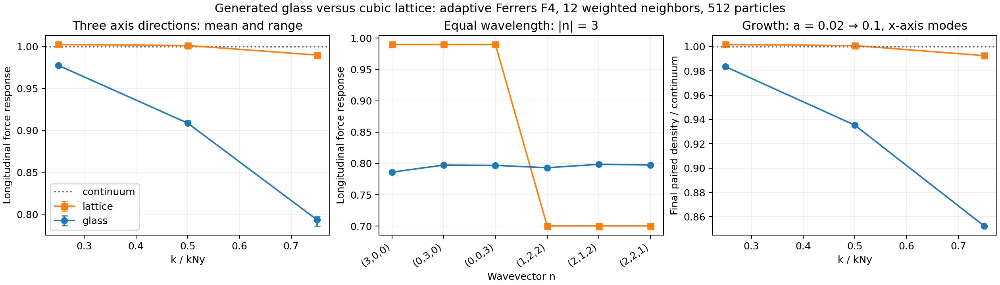
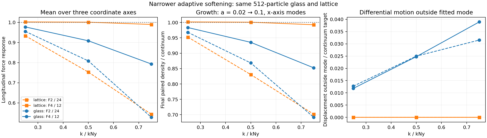

# Glass and lattice growth with Ferrers F4 and 12 weighted neighbors

This repeats the [previous glass/lattice experiment](glass_growth.md), changing
the adaptive gravity kernel from Ferrers F2, `(1-q^2)^2`, with 24 weighted
neighbors to Ferrers F4, `(1-q^2)^4`, with 12 weighted neighbors. Here `q=r/H`
and `H` is the compact support radius. The production settings are
`gravity.kernelDegree=8` and `gravity.neighborNumber=12`.

Both experiments use the same 512 equal-mass dark-matter particles in a periodic
box. The lattice coordinates and the exact generated-glass coordinates are
unchanged. The existing glass is reused to isolate the force-law change; it was
not regenerated or relaxed under the new adaptive prescription. Adaptive
conservation terms remain enabled, with CUDA gravity and opening angle `0.1`.
This experiment does not change application defaults or production cosmological
initial conditions.

The narrower softening roughly halves the glass's shortest measured axis-mode
growth deficit. The lattice's axis modes become much closer to continuum growth,
but its directional force dependence becomes stronger, so those axis results
cannot be generalized to other directions.

## Force response

At displacement amplitude `0.005 Delta`, the mean longitudinal force response
over the three coordinate-axis directions is:

| `k/k_Ny` | Lattice F2 / 24 | Lattice F4 / 12 | Glass F2 / 24 | Glass F4 / 12 |
| ---: | ---: | ---: | ---: | ---: |
| 0.25 | 0.93355 | 1.00245 | 0.95537 | 0.97752 |
| 0.50 | 0.75298 | 1.00126 | 0.80870 | 0.90872 |
| 0.75 | 0.54388 | 0.98988 | 0.52836 | 0.79352 |

The continuum pressure-free response is one. The narrower kernel brings the
glass response closer to it at all three measured wavelengths. The almost
unit response of the lattice axis modes is strongly direction-dependent.

At fixed wavelength `|n|=3`, six directions are compared:
`(3,0,0)`, `(0,3,0)`, `(0,0,3)`, `(1,2,2)`, `(2,1,2)`, and `(2,2,1)`.

| Load | F2 / 24 response range | F2 / 24 span / mean | F4 / 12 response range | F4 / 12 span / mean |
| --- | ---: | ---: | ---: | ---: |
| Lattice | 0.543879–0.599154 | 9.67% | 0.700312–0.989884 | 34.26% |
| Glass | 0.526003–0.530995 | 0.944% | 0.786150–0.798643 | 1.571% |

Thus the narrower softening exposes a larger cubic-lattice directional
signature. The glass remains substantially less directional over these sampled
wavevectors, although one realization and six directions do not establish a
universal anisotropy limit. A short axis mode alone would overstate how close
the lattice comes to continuum dynamics.

The glass maximum force-response RMS outside the fitted axis mode is `0.01922`,
`0.04063`, and `0.06954` at the three wavelengths. These are normalized by
`4*pi*G*rho_comoving` times the imposed displacement amplitude, as in the prior
experiment. The corresponding F2 values were `0.02216`, `0.04637`, and
`0.06094`. At the shortest wavelength the absolute off-mode response is larger,
but the primary response grows more; these absolute RMS values must not be
interpreted directly as fractional noise in the primary response.

Across all 14 measured wavevectors, halving the response displacement from
`0.01 Delta` to `0.005 Delta` changes the projected response matrix by at most
`0.007484%` for the lattice and `0.004243%` for the glass. This is a local force
measurement. A Fourier mode in a glass is not a closed dynamical eigenmode,
so actual growth is measured from full particle trajectories below.

## Actual particle growth

Using the same continuum initial growing velocity as before, the final
Eulerian density amplitude in phase with the initial perturbation, divided by
continuum growth, is:

| `k/k_Ny` | Lattice F2 / 24 | Lattice F4 / 12 | Glass F2 / 24 | Glass F4 / 12 |
| ---: | ---: | ---: | ---: | ---: |
| 0.25 | 0.952439 | 1.001759 | 0.967917 | 0.983495 |
| 0.50 | 0.830439 | 1.000871 | 0.868311 | 0.935353 |
| 0.75 | 0.701610 | 0.992625 | 0.691481 | 0.852412 |

These are density-amplitude ratios, not power ratios. For the shortest glass
axis mode, the amplitude deficit falls from `30.852%` to `14.759%`, a reduction
of about `52.2%`. A substantial deficit remains. The lattice's two longer axis
modes grow slightly faster than continuum, consistent with their initial
force response exceeding one.

The glass differential displacement RMS outside the fitted mode reaches
`1.182%`, `2.477%`, and `3.894%` of the continuum displacement amplitude.
The prior values were `1.274%`, `2.498%`, and `3.155%`: narrowing the softening
improves the primary short-wave growth without eliminating mode mixing.
The final glass density quadrature components, in continuum-signal units, are
`+0.0001014`, `+0.0021366`, and `-0.0000203`.

The unperturbed glass drifts by `0.0079027 Delta` in vector RMS, versus
`0.0162935 Delta` previously. Its final baseline density amplitudes are
`4.486e-5`, `3.393e-4`, and `0.002039`; these common contributions are removed
by the positive/negative difference. The maximum even density residuals are
`1.18e-6`, `2.95e-5`, and `1.44e-4` of the continuum differential signal.
The baseline is evolved throughout; its initial force is not assumed to vanish.





## Equal-wavelength growth in an oblique direction

The additional `(2,2,1)` perturbation has exactly the same wavelength as
`(3,0,0)`, with `k/k_Ny=0.75`, and the same initial displacement magnitude,
continuum velocity, interval, and eight time steps. With F4 / 12, its final
in-phase density ratios are:

| Load | Axis `(3,0,0)` | Oblique `(2,2,1)` |
| --- | ---: | ---: |
| Lattice | 0.992625 | 0.796985 |
| Glass | 0.852412 | 0.860993 |

The lattice therefore retains a `20.3%` oblique growth deficit even though its
axis deficit is only `0.74%`. Its near-continuum axis result does not demonstrate
uniform recovery of continuum growth. The two glass directions differ by
`0.00858` in density ratio and both retain a roughly `14–15%` deficit.

The oblique lattice develops a transverse sine displacement of `2.160%` of the
continuum displacement amplitude. This motion remains at the imposed wavevector
and is distinct from the much smaller residual outside the fitted mode.
For the oblique glass, the corresponding transverse displacement is `0.0431%`,
while the displacement RMS outside the fitted mode is `3.950%` and the density
quadrature ratio is `-0.0029625`. The [oblique comparison table](glass_growth_f4_12_results/oblique_comparison.csv)
retains both types of motion and the initial force responses.

## Time-step and amplitude controls

Both loads were rerun for `(3,0,0)`, independently doubling the RK4 steps and
halving the initial displacement and velocity. Final in-phase density ratios
are:

| Load | Main: 8 steps, `0.001 Delta` | 16 steps | Half amplitude, 8 steps |
| --- | ---: | ---: | ---: |
| Lattice | 0.992625205 | 0.992642475 | 0.992621795 |
| Glass | 0.852412378 | 0.852419736 | 0.852418584 |

Doubling the steps changes the primary result by `0.001740%` for the lattice
and `0.000863%` for the glass. Halving the amplitude changes it by `-0.000344%`
and `+0.000728%`, respectively. These are relative changes in the density
ratio, not percentage-point changes. They are much smaller than the measured
growth deficits or the change between the two softening settings.

For the glass, the normalized even displacement residual falls from
`0.00039708` to `0.00019872` when the amplitude is halved, as expected for
an even response divided by a first-order amplitude. The controls establish
accuracy for the shortest axis mode and the measured interval; they are not
a convergence demonstration for arbitrary directions or nonlinear evolution.
Exact values are retained in [growth_controls.csv](glass_growth_f4_12_results/growth_controls.csv).

## Softening scale and particle load

The initial mean support radii are `1.392420 Delta` for the lattice and
`1.423797 Delta` for the glass, where `Delta=L/8`. For the three-dimensional
Ferrers family `(1-q^2)^p`, the second-moment width is

\[
2\sigma = \frac{2H}{\sqrt{2p+5}}.
\]

The F4 widths are therefore approximately `0.7724 Delta` and `0.7898 Delta`.
These are `35.0%` and `33.4%` smaller than their F2 / 24 counterparts.
The weighted-neighbor target includes the particle itself: F4 contributes
`9.0234375` at the origin. A target of 12 is not a literal count of 12 other
particles. This makes particle arrangement and the shape of the weighting
function essential when interpreting the target.

Both loads use `k_Ny=pi/Delta` as a common reference wavenumber. A disordered
glass does not have the exact sampling symmetries of a cubic lattice.

The initial glass force RMS is `0.0077330` in units with
`G*rho_comoving=1` and `L=1`, compared with `0.0155688` for F2 / 24.
The lattice force RMS is `3.1850e-7`. A small initial force does not imply an
exact equilibrium; the paired evolution measures the unperturbed load drift.

## Method and scope

The force experiment measures 14 wavevectors at two displacement amplitudes,
using symmetric positive and negative perturbations and a joint least-squares
fit of constant, sine, and cosine. The three axis growth cases use sinusoidal
amplitude `0.001 Delta`, the continuum growing velocity, and eight RK4 steps
from `a=0.02` to `0.1` (`z=49` to `9`). Each case evolves positive, negative,
and zero perturbations. The primary result is the difference in actual Eulerian
density Fourier coefficients, normalized to its realized initial value and
the continuum growth of the same background.

The zero trajectory records common glass drift. The even residual around it
and the differential motion outside the initial mode are retained. Separate
shortest-axis controls double the time steps and halve the initial amplitude
for both particle loads. An additional paired `(2,2,1)` mode has the same
wavelength and initial displacement magnitude as `(3,0,0)` and directly checks
the short-scale directional dependence in growth.

The harness recomputes production gravity at every RK4 stage. It tests the
force solver and cosmological growth equation, not the production driver's
block timestep implementation. Radiation affects background expansion only;
radiation perturbations, gas pressure, and a gas/dark-matter split are absent.
Results from one small glass realization are not a production IC calibration.

The detailed projection, density, and load-quality definitions remain in the
[original report](glass_growth.md). The original archive and its provenance
remain unchanged. The new [result archive](glass_growth_f4_12_results/) retains
the requested configurations, exact glass, raw outputs, validated summaries,
comparison figures, and manifest separately.

## Validation and reproduction

The response and growth analyses check complete, finite, request-matched data
and the realized initial states. The cross-experiment comparison checks exact
glass-coordinate equality and matching particle counts, class masses,
background, force backend, opening angle, intervals, amplitudes, and step counts.
Only the kernel degree and neighbor target differ in that comparison.

An independent analytic periodic all-pairs count solve agrees with the measured
support radii for both kernels and both loads. Its full results, including
support scatter, actual particles within support, and constraint derivatives,
are in [initial_support_check.json](glass_growth_f4_12_results/initial_support_check.json).
The separate F4 / 12 conservation check passed analytic derivatives, pair
symmetry, re-solved energy gradients, and active support bounds for equal and
unequal particle classes. The focused `adaptive_softening_cuda` CTest also
passed. These checks do not constitute a rerun of the complete repository test
suite. The main growth and comparison plots were visually inspected.

From the repository root, repeat the simulation campaign in a new directory:

```sh
OPENBLAS_NUM_THREADS=1 python3 -B docs/glass_growth_f4_12_results/run_experiment.py \
  --output-dir /tmp/cosmictiger_f4_12_repeat
```

The runner uses the existing release executable and two four-thread processes,
and rejects an existing output directory. Each load runs the main measurement,
two convergence controls, and the oblique measurement in sequence. The exact
historical driver scripts and per-run commands are also archived.

`tests/analyze_glass_growth.py` provides the validated `response`, `growth`,
and `comparison` analysis commands described in the original report. In this
archive, `adaptive_glass` contains both the raw force and raw growth data;
`evolution_glass/analysis` holds its growth summaries. The `orientation_*`
directories contain the same complete validated response summaries, used by
the comparison plot to select the three tilted modes; they do not represent
additional simulation runs. Each `control_*` and `oblique_*` directory contains
the corresponding growth summaries.

To rebuild the comparison between archived F2 and F4 results, including the
two-load control and oblique-comparison tables:

```sh
OPENBLAS_NUM_THREADS=1 python3 -B docs/glass_growth_f4_12_results/compare_settings.py \
  docs/glass_growth_results docs/glass_growth_f4_12_results
```
