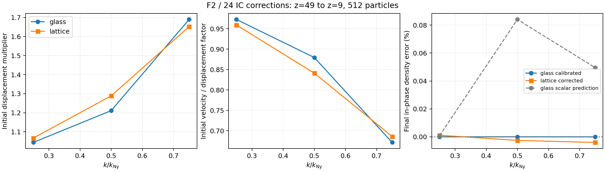
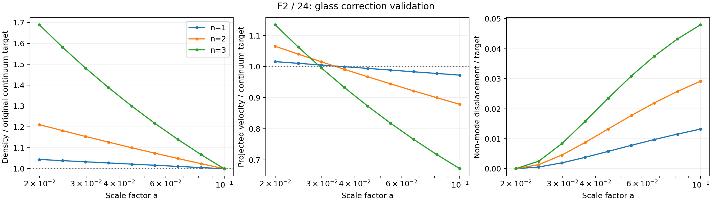

# Initial displacement and velocity corrections for the F2 / 24 glass

This experiment derives and directly tests initial-condition corrections for
the saved 512-particle glass with adaptive Ferrers F2 gravity, `(1-q^2)^2`,
24 weighted neighbors, and adaptive conservation terms. The target is the
original continuum density amplitude at `a=0.1`, starting at `a=0.02`
(`z=49` to `z=9`). The comparison uses the earlier **one-class dark-matter
lattice** calculation, with the same mass, background, softening, and particle
count. The earlier mixed gas/dark-matter example is a different system.

The glass correction is an explicitly approximate scalar growing-velocity
prescription plus an empirical displacement calibration. It is not an exact
glass eigenmode or a universal function of wavenumber. Production initial
conditions and defaults are unchanged.

## Measured correction and lattice comparison

The final calibrated glass coefficients, relative to the same consistent
continuum IC, are:

| `k/k_Ny` | Glass displacement | Lattice displacement | Glass velocity/displacement | Lattice velocity/displacement | Glass total velocity | Lattice total velocity |
| ---: | ---: | ---: | ---: | ---: | ---: | ---: |
| 0.25 | 1.044368 | 1.067214 | 0.972836 | 0.959303 | 1.015999 | 1.023781 |
| 0.50 | 1.211286 | 1.288913 | 0.879547 | 0.841204 | 1.065383 | 1.084239 |
| 0.75 | 1.689621 | 1.651784 | 0.671447 | 0.685938 | 1.134491 | 1.133021 |

The glass needs a smaller displacement correction for the first two modes and
a slightly larger one for the shortest mode. Direct validation with initial
continuum amplitude `0.001 Delta` and eight RK4 steps gives:

| `k/k_Ny` | Glass final in-phase density / target | Lattice final in-phase density / target | Glass final projected velocity / target | Lattice final projected velocity / target |
| ---: | ---: | ---: | ---: | ---: |
| 0.25 | 0.99999996 | 1.00001131 | 0.972569 | 0.959454 |
| 0.50 | 1.00000009 | 0.99997441 | 0.878532 | 0.841633 |
| 0.75 | 0.99999975 | 0.99995987 | 0.671486 | 0.686901 |

The near-exact glass density match is an empirical match to that amplitude and
target epoch. It is **not a `1e-7` claim about the linear-limit solution**.
For the shortest glass mode, doubling to 16 steps changes density by
`+2.15e-6` relative (`+0.000215%`) and projected velocity by `+6.75e-6`
(`+0.000675%`). Halving the perturbation while retaining the same correction
changes density by `-6.00e-5` (`-0.00600%`) and projected velocity by
`-1.74e-4` (`-0.01740%`). The amplitude check therefore sets the more useful
accuracy scale for these coefficients. The corresponding control density
ratios are `1.00000190` and `0.99993976`.

Density matching leaves the expected slower velocity evolution: the shortest
glass mode reaches only `67.15%` of the continuum projected velocity. It also
leaves differential displacement outside the fitted mode of `1.32%`, `2.92%`,
and `4.80%` of the original continuum displacement target. Final density phase
ratios are `+0.0001886`, `+0.0034493`, and `-0.0007413`. The maximum even density
residual is `0.000376` of the target, and the zero glass trajectory drifts by
`0.0162935 Delta` RMS. Thus matching one density projection does not recover
the complete continuum particle motion or erase the particular glass's noise.





## Scalar prediction and empirical calibration

The initial glass force response is measured with central positive and negative
sinusoidal displacements of `0.005 Delta`, where `Delta=L/8`. For an imposed
longitudinal displacement, take

\[
\lambda_{\rm eff}(\boldsymbol{k})=
\hat{\boldsymbol{k}}^{\mathsf T}M_{\rm sine}(\boldsymbol{k})
\hat{\boldsymbol{k}}.
\]

This is the projected initial response, **not an eigenvalue of the full glass**.
The three x-axis values are `0.95536848`, `0.80955606`, and `0.52600265` at
`k/k_Ny=0.25, 0.50, 0.75`. The background solver then integrates

\[
D_\lambda''+
\left(2+\frac{d\ln H}{d\ln a}\right)D_\lambda'
-\frac32\Omega_m(a)\lambda_{\rm eff}D_\lambda=0,
\qquad f_\lambda=D_\lambda'/D_\lambda,
\]

using the regular smooth-radiation branch and the runtime matter, radiation,
curvature, and Lambda background. Primes denote derivatives with respect to
`ln(a)`. The scalar prediction is

\[
R_{\rm model}=\frac{D_1(a_t)/D_1(a_i)}
{D_\lambda(a_t)/D_\lambda(a_i)},\qquad
\boldsymbol\Psi_i=R_{\rm model}\boldsymbol\Psi_{\rm fluid,i},\qquad
\boldsymbol p_i=a_i^2H_i f_\lambda(a_i)\boldsymbol\Psi_i.
\]

`p=a^2 dx/dt` is the code's stored momentum variable; physical peculiar velocity
is `p/a`. At fixed initial epoch, the total velocity multiplier relative to
the consistent continuum IC is `R * f_lambda/f_1`. A smaller velocity per
unit displacement can therefore coexist with a larger total initial velocity.
All factors here are relative to a continuum IC consistent with the runtime
background. The normal initializer's separate matter-plus-Lambda background
approximation, discussed in [the earlier lattice report](linear_growth.md#existing-cosmological-background-approximations),
is unchanged; these tables do not silently include that separate correction.

| `k/k_Ny` | Predicted glass displacement `R_model` | Approximate glass velocity/displacement `f_lambda/f_1` | Predicted total velocity multiplier |
| ---: | ---: | ---: | ---: |
| 0.25 | 1.04437627 | 0.97283618 | 1.01600702 |
| 0.50 | 1.21230432 | 0.87954730 | 1.06627899 |
| 0.75 | 1.69045762 | 0.67144682 | 1.13505239 |

These displacement factors differ from simply taking the inverse of the
previous measured density deficits. For example, `1/0.69148 = 1.44617` for
the shortest uncorrected glass mode retains the continuum velocity per unit
displacement. The prescription here lowers that rate to approximately `0.67145`
of the continuum value to approximate the slower numerical growing branch,
so its displacement prediction is larger, approximately `1.69046`.

Full paired positive, negative, and zero trajectories test these seeds using
production gravity at every RK4 stage. The empirical density calibration uses
the measured in-phase final ratio `Q_model`:

\[
R_{\rm calibrated}=R_{\rm model}/\operatorname{Re}Q_{\rm model}(a_t).
\]

The approximate velocity/displacement ratio is retained, and a separate set
of full trajectories validates the calibrated seeds. This calibration changes
both displacement and velocity together. It does not fit the final velocity
to the continuum value or cancel the glass's phase mixing.

The scalar prediction alone gives measured final density ratios
`1.00000758`, `1.00084056`, and `1.00049488`. Its largest in-phase error is
therefore `0.0841%` for these modes. The resulting empirical displacement
factors are `1.04436835`, `1.21128616`, and `1.68962146`.

## What the comparisons measure

Every density ratio uses the **original, uncorrected** paired initial Fourier
density, rather than the larger corrected initial amplitude:

\[
Q_{\rm target}(a)=
\frac{\delta_{\rm corrected,diff}(\boldsymbol k,a)}
{\delta_{\rm original,diff}(\boldsymbol k,a_i)
D_1(a)/D_1(a_i)}.
\]

The real part measures density in phase with that original target, and the
imaginary part measures residual phase error. The half-amplitude control uses
one half of the same original target. This normalization tests recovery of the
requested density amplitude; renormalizing by the corrected initial density
would measure a different question.

Velocity results are the fixed-reference longitudinal sine projection of
`d(displacement)/dln(a)`, divided by the original continuum displacement target
times `f_1(a)`. They are proportional to the stored momentum and peculiar
velocity at that epoch. They are **not** the derivative of Eulerian Fourier
density. The projected velocity cosine component, particle displacement outside
the fitted sine/cosine mode, unperturbed glass drift, and even residuals are
retained separately.

The glass's Fourier waves do not evolve independently. The baseline also drifts
under adaptive gravity, so its force Jacobian changes with time. These effects
are included in the full trajectories and are why the initial scalar model
requires validation and calibration. A full numerical growing-branch treatment
would require the particle-space response and its mixed modes. The distinction
is consistent with [Garrison et al. (2016), section 5.5](https://arxiv.org/html/1605.02333v3#S5.SS5),
which explains that the lattice's separate Fourier eigenproblems become one
`3N by 3N` problem for a glass.

## Validation and reproducibility

The analysis rejects missing or duplicated trajectory records, nonfinite
samples, mismatched labels, incorrect scale factors, wrong initial projected
states, inconsistent gravity/background settings, and mismatched saved-glass
bytes. Seven synthetic checks verify original-target normalization with a
known 1.7 displacement/velocity boost, half-target scaling, exact recovery of
a known empirical rescaling, and rejection of corrupt inputs.

The lattice reference is independently recomputed through the Riccati equation
for `f=dln(D)/dln(a)` and agrees with the earlier direct growth-equation results
to approximately `5e-12` in the displacement factors. The new direct lattice
trajectories use CUDA gravity; the reference correction was derived from the
earlier pure-DM response measurements. No new C++ physics changes are needed.
All five production invocations completed successfully: eleven paired cases,
or 33 positive, negative, and zero trajectories. Independent reanalysis of the
archived raw data reproduced all five summaries and trajectory tables byte for
byte. Regenerating the model, calibration, and comparison also reproduced all
eleven coefficient, request, and comparison files byte for byte.
The comparison and calibrated
growth figures were visually inspected. This experiment changes analysis and
documentation only; the full repository CTest suite was not rerun.

The saved glass coordinates, requests, raw trajectories, logs, analysis tables,
and provenance are retained in [glass_ic_corrections_results](glass_ic_corrections_results/).
The analysis script is [analyze_glass_ic_corrections.py](../tests/analyze_glass_ic_corrections.py).
From the source directory:

```sh
GLASS_IC_WORK_DIR="$PWD/build/release/tests/glass_ic_reproduction"

OPENBLAS_NUM_THREADS=1 python3 -B tests/analyze_glass_ic_corrections.py prepare \
  docs/glass_growth_results docs/glass_ic_corrections_results

python3 -B docs/glass_ic_corrections_results/run_experiment.py model \
  --work-root "$GLASS_IC_WORK_DIR"

OPENBLAS_NUM_THREADS=1 python3 -B tests/analyze_glass_ic_corrections.py analyze \
  docs/glass_growth_results "$GLASS_IC_WORK_DIR/model_glass" \
  docs/glass_ic_corrections_results/requests_model.csv \
  docs/glass_ic_corrections_results/model_glass/analysis

OPENBLAS_NUM_THREADS=1 python3 -B tests/analyze_glass_ic_corrections.py calibrate \
  docs/glass_growth_results docs/glass_ic_corrections_results \
  docs/glass_ic_corrections_results/model_glass/analysis/summary.json

python3 -B docs/glass_ic_corrections_results/run_experiment.py calibrated \
  --work-root "$GLASS_IC_WORK_DIR"

OPENBLAS_NUM_THREADS=1 python3 -B tests/analyze_glass_ic_corrections.py analyze \
  docs/glass_growth_results "$GLASS_IC_WORK_DIR/control_half_glass" \
  docs/glass_ic_corrections_results/requests_control_half.csv \
  docs/glass_ic_corrections_results/control_half_glass/analysis --target-scale .5

OPENBLAS_NUM_THREADS=1 python3 -B tests/analyze_glass_ic_corrections.py self-check
```

The work directory must be new: the runner refuses to overwrite an existing
run. Repeat `analyze` for `calibrated_glass`, `corrected_lattice` (with
`--load lattice`), and `control_16_glass`, using their corresponding request
files. Once all analyses are complete, run
`compare docs/glass_ic_corrections_results` to reproduce the comparison table
and figure. The saved run script supplies the production command lines.

This is a one-realization, gravity-only linear experiment with 512 equal-mass
particles. Corrections are tied to the chosen start and target epochs. The
results do not establish a correction for arbitrary glasses, mixed particle
classes, hydro pressure, nonlinear evolution, or the production block-timestep
driver.

## Optional two-endpoint diagnostic

The [endpoint diagnostic](glass_ic_corrections_results/endpoint_diagnostic.json)
uses the original continuum-velocity run and the new model run as two
independent initial-state families. Their measured final in-phase density and
projected longitudinal velocity define a two-by-two linear map. Inverting it
to match both endpoint observables illustrates a different problem from
approximating the numerical growing branch.

For the shortest glass mode the inferred initial displacement multiplier is
approximately `-3.88`, with total initial velocity multiplier `8.26`; the
corresponding lattice values are `-3.64` and `7.96`. These deliberately reverse
the initial density phase and add a large transient to hit both endpoint
targets. They are **linear-superposition predictions, not independently
evolved or recommended ICs**. The initial-family and endpoint-map condition
numbers, phase residuals, and complete coefficients are retained in the
diagnostic output. The velocity observable remains the Lagrangian projection
defined above.
