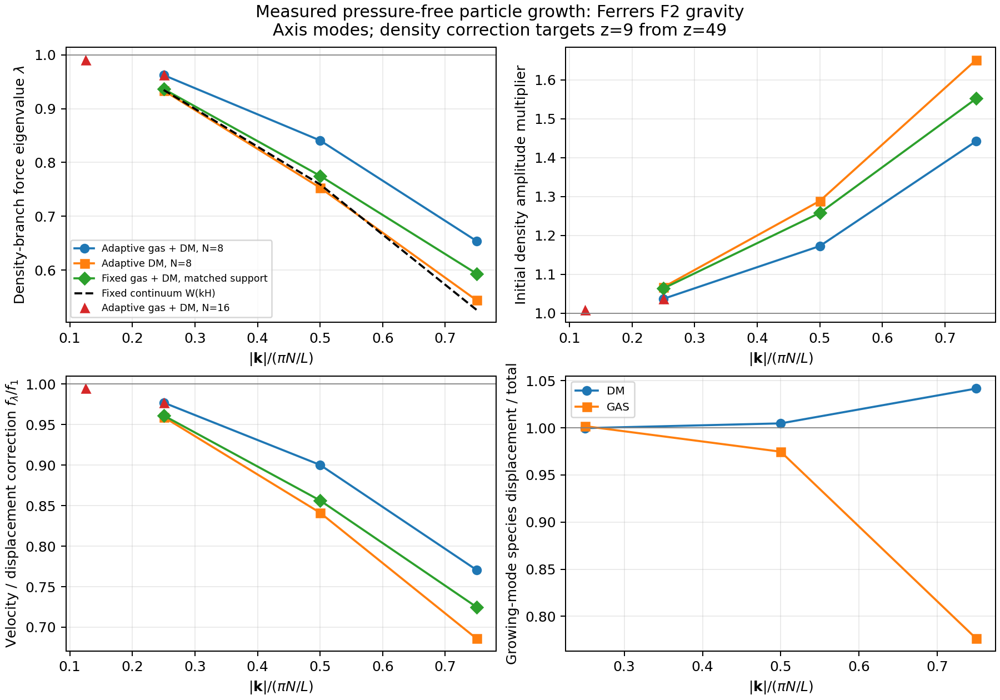
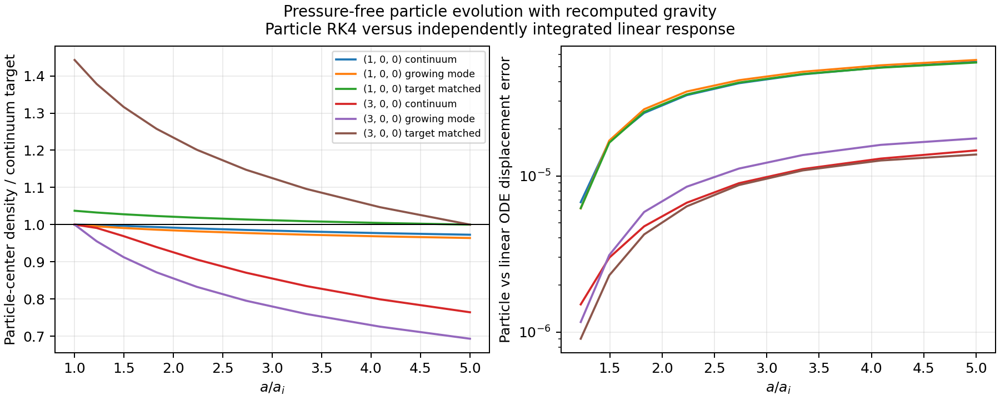

# Linear growth with independent gravitational softening

This diagnostic measures the implemented gravitational response and derives
linear initial-condition corrections. It does not enable a correction in the
normal cosmological initializer.

The [generated-glass comparison](glass_growth.md) extends this diagnostic to
disordered particle loads and paired positive, negative, and unperturbed
trajectories. Its primary growth measurement uses actual Fourier densities;
the lattice eigenmode correction below is not applied to a glass.

## Measured response and example corrections

The default gravity configuration is Ferrers F2 (`(1-q^2)^2`), 24 weighted
neighbors, and adaptive conservation terms. The mixed experiment uses
`Omega_c=0.26503`, `Omega_b=0.049389`, and `N=8` per species. The following
axis-aligned results target growth from `z=49` to `z=9`. Here
`k_Ny = pi*N/L` is the per-species axis Nyquist wavenumber. `R` multiplies the
initial total-density mode amplitude; the last two columns describe the
species eigenvector, before multiplying by `R`.

| `k/k_Ny` | Force eigenvalue | Initial amplitude `R` | Velocity per displacement `f_lambda/f_1` | DM vector amplitude | Gas vector amplitude |
| ---: | ---: | ---: | ---: | ---: | ---: |
| 0.25 | 0.96232 | 1.03728 | 0.97710 | 0.99967 | 1.00175 |
| 0.50 | 0.84086 | 1.17291 | 0.90022 | 1.00472 | 0.97468 |
| 0.75 | 0.65400 | 1.44271 | 0.77066 | 1.04166 | 0.77643 |

For example, the shortest axis mode needs initial displacements of approximately
`1.50281` times the original common amplitude for DM and `1.12016` for gas to
seed its numerical growing mode and match **total** density at `z=9`. Its gas/DM
contrast-amplitude ratio remains about `0.7454`. This is a significant
resolution-dependent bias that a total-density correction alone does not fix.
The `(2,1,0)` mode also has a transverse eigenvector component of about 1.2%,
demonstrating that the discrete correction is not purely a function of `|k|`.

The pure-DM axis responses are `0.93350`, `0.75298`, and `0.54388` at the same
three `k/k_Ny` values. Its support is larger because the same neighbor target
is drawn from one lattice instead of two: `H/Delta=1.78207`, versus `1.39973`
in the mixed case. The `N=16` mixed longest mode has `lambda=0.99080` at
`k/k_Ny=0.125`; mode `(2,0,0)` gives `0.96221`, within `1.03e-4` of the `N=8`
result at the same dimensionless wavelength.

With fixed comoving support matched to the mixed lattice's adaptive baseline,
the axis responses are `0.93650`, `0.77511`, and `0.59334`. The corresponding
fixed-kernel continuum window values are `0.93467`, `0.75918`, and `0.52604`.
The measured adaptive response is less suppressed in these modes, and the
discrete response differs from the kernel window even at fixed support.



Complete matrices, metadata, correction tables, and plots are retained in
[linear_growth_results](linear_growth_results/). The table above is a
calibration example for these discrete modes, not a universal interpolation
table for arbitrary particle arrangements or kernels.

### Direct particle evolution

Six gravity-driven particle evolutions used modes `(1,0,0)` and `(3,0,0)`,
initial continuum mode amplitude `0.001*Delta`, and eight RK4 steps in `ln(a)`
from `a=0.02` to `0.1`. The baseline uses continuum displacements and the exact
same-background continuum growth rate, which isolates numerical gravity from
the existing initializer's background approximation described below.

| Mode | Initial condition | Final density / continuum target |
| --- | --- | ---: |
| `(1,0,0)` | Common continuum displacement and velocity | 0.972811 |
| `(1,0,0)` | Numerical eigenvector and growing velocity | 0.964008 |
| `(1,0,0)` | Numerical growing mode plus target amplitude rescaling | 0.999944 |
| `(3,0,0)` | Common continuum displacement and velocity | 0.764332 |
| `(3,0,0)` | Numerical eigenvector and growing velocity | 0.693143 |
| `(3,0,0)` | Numerical growing mode plus target amplitude rescaling | 1.000007 |

The maximum relative difference between the particle trajectory's sine
projection and the independent measured-matrix ODE is `5.52e-5` for displacement
and `6.63e-5` for its logarithmic derivative across these runs. The largest
non-mode displacement RMS is `9.53e-4` relative to mode amplitude. At the target
epoch the density-corrected long/short modes have total momenta `0.977101` and
`0.771356` times their continuum targets, directly demonstrating the remaining
velocity mismatch.

For the corrected short mode, doubling the RK4 step count from 8 to 16 changes
the final density ratio by `4.93e-6` (from `1.00000674` to `1.00001167`). Halving
the initial amplitude gives `1.00000219`, a change of `-4.55e-6`, and reduces
the relative non-mode RMS from `9.53e-4` to `5.04e-4`. These controls support
the linear interpretation and bound the measured time/amplitude sensitivity
for this mode. They do not imply this accuracy for nonlinear cosmological runs.



### Response accuracy

The main mixed `N=8` response used opening angle `0.1` and perturbations of
`0.01` and `0.005` spacings. Across its eight wavevectors, the largest relative
mass-weighted symmetry residual is `1.15e-4`, cosine contamination `4.77e-5`,
and amplitude-change matrix residual `1.42e-4`. The CPU/CUDA pilot matrices at
opening angle `0.2` agree to `1.19e-5` in relative sine-response matrix norm
(`2.17e-5` when including the cosine response). At opening angle `0.1`, the
independent CPU regression and CUDA measurement agree to `4.80e-5` and
`9.80e-5` in full complex matrix norm for amplitudes `0.01` and `0.005`.
Tightening the
opening angle changes that pilot's selected eigenvalue by about `2.8e-5` and
substantially improves matrix symmetry.

The larger `N=16` check has matrix residuals up to about `9.3e-4`, so its
eigenvalue agreement does not establish the same precision for every matrix
component. No accuracy claim here extends to arbitrary nonlinear particle
arrangements, hydro pressure, 2LPT, or the production timestep driver.

The Release build succeeded. The new `linear_growth_response` regression,
`grouped_options`, and `adaptive_softening` CTests passed (3/3). Analytical
analysis checks passed for EdS growth, the regular Meszaros solution, and the
Ferrers Fourier transform. Incomplete, duplicate, missing-run, and
wrong-initial-state evolution records are rejected by the analysis checks.

## What is measured

`run.test=linearGrowth` places dark matter on a cubic lattice and, when
`hydro.enabled=true`, gas on a second lattice offset by half a cell in every
direction. There are `N^3` particles per species, with the usual constant class
masses. Both species are pressure-free in this diagnostic. No SPH pressure,
thermal evolution, or second-order Lagrangian terms are included.

For each wavevector, central positive/negative sinusoidal displacements of
each Cartesian component and species measure the acceleration Jacobian:

\[
\delta\boldsymbol g=4\pi G\bar\rho_{\rm com}\,
M(\boldsymbol k)\boldsymbol\Psi.
\]

The matrix is 3 by 3 for one species and 6 by 6 for two. The production gravity
solver supplies the forces, including periodic Ewald terms, the selected
kernel, the adaptive support solve, and its conservation terms. The denominator
uses the realized fixed-point displacement. The results include sine and cosine
projections, support radii, and the unperturbed residual force.

The optional evolution test stores particle displacements and their derivatives
with respect to `ln(a)` in double precision and integrates them with RK4. Every
stage rebuilds the particles and evaluates production gravity. Thus this tests
the spatial solver and cosmological growth equation; it does not test the
production driver's block timestep integration. An independent SciPy ODE
solution predicts the evolution from the measured response matrix.

## Initial displacement and velocity corrections

Let `f_c` and `f_b` be the class mass fractions. The conservative response is
self-adjoint in mass-weighted coordinates. Diagonalize

\[
S=WMW^{-1},\qquad
W=\operatorname{diag}(\sqrt{f_c},\sqrt{f_c},\sqrt{f_c},
                     \sqrt{f_b},\sqrt{f_b},\sqrt{f_b}).
\]

The diagnostic reports the symmetry residual before symmetrization. It selects
the eigenvector with the largest total longitudinal density overlap, rather
than assuming that the largest eigenvalue is the appropriate branch. Its
physical eigenvector is normalized by
\(\sum_s f_s\hat{\boldsymbol k}\cdot\boldsymbol v_s=1\).
All eigenvalues and vector components are retained so that branch selection can
be inspected. A production correction table would also need branch tracking
over its full wavevector grid.

For the selected eigenvalue `lambda`, solve

\[
D_\lambda''+
\left(2+\frac{d\ln H}{d\ln a}\right)D_\lambda'
-\frac32\Omega_m(a)\lambda D_\lambda=0,
\qquad f_\lambda=\frac{D_\lambda'}{D_\lambda},
\]

where primes mean derivatives with respect to `ln(a)`. The background matches
`cosmosDadt`, including radiation, curvature, matter, and Lambda. For the present
pressure-free experiment the radiation density affects expansion only. The
regular smooth-radiation (Meszaros) branch defines the growing solution; this is
not a replacement for a Boltzmann transfer calculation with radiation and
baryon perturbations.

To match the continuum **total particle-center density amplitude** at a chosen
target `a_t`, starting at `a_i`, use

\[
R_\Psi=\frac{D_1(a_t)/D_1(a_i)}{D_\lambda(a_t)/D_\lambda(a_i)},
\qquad
\boldsymbol\Psi_{s,i}=R_\Psi\boldsymbol v_s\Psi_{\rm fluid,long},
\qquad
\boldsymbol p_{s,i}=a_i^2H_i f_\lambda(a_i)\boldsymbol\Psi_{s,i}.
\]

Here `p = a^2 dx/dt` is the code's stored momentum/velocity variable; physical
peculiar velocity is `p/a`. Relative to an otherwise consistent continuum IC,
the total momentum multiplier is `R_Psi * f_lambda/f_1`, with the species
eigenvector also applied. The velocity factor cannot be omitted: continuum
velocities generally excite a decaying numerical mode.

In an Einstein-de Sitter background these expressions become

\[
p_+=\frac{\sqrt{1+24\lambda}-1}{4},\qquad
D_\lambda\propto a^{p_+},\qquad
R_\Psi=(a_t/a_i)^{1-p_+},\qquad f_\lambda=p_+.
\]

This follows the particle-linear-theory approach of
[Garrison et al. (2016)](https://arxiv.org/html/1605.02333v3), using the measured
adaptive, unequal-class-mass response here.

### The target observable matters

Matching total density at `a_t` does not make the numerical growing rate equal
to the continuum rate. The velocity at that epoch still differs by
`f_lambda(a_t)/f_1(a_t)`. A two-species eigenmode can also have unequal gas and
DM fractional displacements, so matching total density does not independently
match both species' densities. These are material limitations near the particle
resolution scale. The correction is tied to its chosen epoch and is not a
recovery of unresolved structure at every time.

It is mathematically possible to match both species' displacements and
velocities at one endpoint. If `F(a_t,a_i)` is the full first-order state
transition matrix, choose
`[Psi_i, Psi_i'] = inverse(F) [Psi_target, Psi_target']`. The measured response
shows why this is a poor default prescription: for mode `(3,0,0)` and the
same `z=49` to `z=9` interval, unit common continuum initial displacement
would require initial DM/gas displacements `-2.50117, -3.81552` and logarithmic
derivatives `6.47083, 7.64941`. Reversed phases and large velocities deliberately
seed decaying and relative-species modes to hit the endpoint. These numbers
come from forward/backward linear ODE calculations, not an additional particle
simulation. The independent forward ODE check recovers the endpoint to about
`1e-11`, confirming that this behavior is not inversion noise.

This calculation targets density inferred from particle centers, as in the
usual N-body displacement construction. Density reconstructed by spreading
each particle with the softening kernel is a different observable. For fixed
common support `H`, the continuum force response for Ferrers F2 is

\[
\widetilde W(kH)=105\,j_3(kH)/(kH)^3,
\]

with limit one at zero. There is one kernel transform for the implemented
softened pair potential. Neither dividing the IC by this window nor by its
square accounts for the discrete lattice and adaptive conservation response.

### Existing cosmological background approximations

`initialize.cpp` currently uses a matter-plus-Lambda approximate growth factor,
growth rate, and Hubble rate, while runtime expansion includes radiation. At
the default cosmology and `a_i=0.02`, the existing `f` is about 0.999990 and the
consistent pressure-free runtime-background value is 0.990184. The old
`D(a_i)/D(1)` is 0.0254237, versus 0.0256393 for this diagnostic's regular
runtime-background solution.

The primary correction columns isolate numerical gravity by starting from
the same continuum initial amplitude. Additional CSV columns include the
background growth and Hubble factors needed when comparing directly with the
existing initializer for the same spectrum normalized at `a=1`. This separate
background consistency issue has not been changed by the diagnostic.

## Reproduction

Build the usual Release target. Run the following from a new output directory,
setting `SOURCE` to the absolute repository path. Dependencies for analysis are
Python, NumPy, SciPy, and Matplotlib; the CTest wrapper uses only Python's
standard library.

```sh
SOURCE=/path/to/cosmictiger
COSMICTIGER_LINEAR_GROWTH_MODES='1,0,0;2,0,0;3,0,0;1,1,0;2,2,0;1,1,1;2,2,2;2,1,0' \
"$SOURCE/build/release/cosmictiger" --run.test=linearGrowth \
  --initial.particlesPerDimension=8 --hydro.enabled=true --compute.cuda=true \
  --gravity.openingAngle=0.1 --hpx:threads=4 --hpx:bind=none > run.log 2>&1

python3 "$SOURCE/tests/analyze_linear_growth.py" \
  linear_growth_response.csv linear_growth_metadata.json analysis \
  --a-initial .02 --a-final .1 --evolution-amplitude .001 --evolution-steps 8

COSMICTIGER_LINEAR_GROWTH_SKIP_RESPONSE=1 \
COSMICTIGER_LINEAR_GROWTH_EVOLVE_FILE="$PWD/analysis/linear_growth_evolution_requests.csv" \
"$SOURCE/build/release/cosmictiger" --run.test=linearGrowth \
  --initial.particlesPerDimension=8 --hydro.enabled=true --compute.cuda=true \
  --gravity.openingAngle=0.1 --hpx:threads=4 --hpx:bind=none > evolution.log 2>&1

python3 "$SOURCE/tests/analyze_linear_growth.py" \
  linear_growth_response.csv linear_growth_metadata.json analysis \
  --a-initial .02 --a-final .1 --evolution-amplitude .001 --evolution-steps 8 \
  --evolution linear_growth_evolution.csv
```

The default central-difference amplitudes are `0.01,0.005` times the per-species
lattice spacing. Set `COSMICTIGER_LINEAR_GROWTH_AMPLITUDES` to override them.
The experiment requires one locality, a cubic lattice, and `4 <= N <= 32`;
component Nyquist modes are rejected because the sampled sine can vanish.

For a pure-DM control set `--hydro.enabled=false --compute.cuda=false`. The
fixed-support mixed control uses `--gravity.softeningMode=fixed` and
`--gravity.supportRadius=1.3997290134429932`, matching the adaptive unperturbed
support in units of the per-species spacing. The finer-lattice control uses
`N=16`, modes `1,0,0;2,0,0`, and amplitude `0.005`. Both CPU and CUDA pilots used
`N=8`, mode `1,0,0`, amplitude `0.01`, and opening angle `0.2`.

Run the bounded regression with `ctest --test-dir build/release -R
'^linear_growth_response$' --output-on-failure`. The analysis self-checks are
`python3 tests/analyze_linear_growth.py --self-check`: EdS power laws, the
regular Meszaros solution, and the Ferrers Fourier transform versus independent
radial quadrature.
