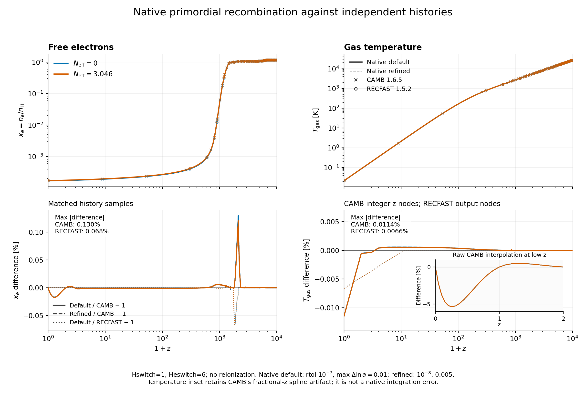
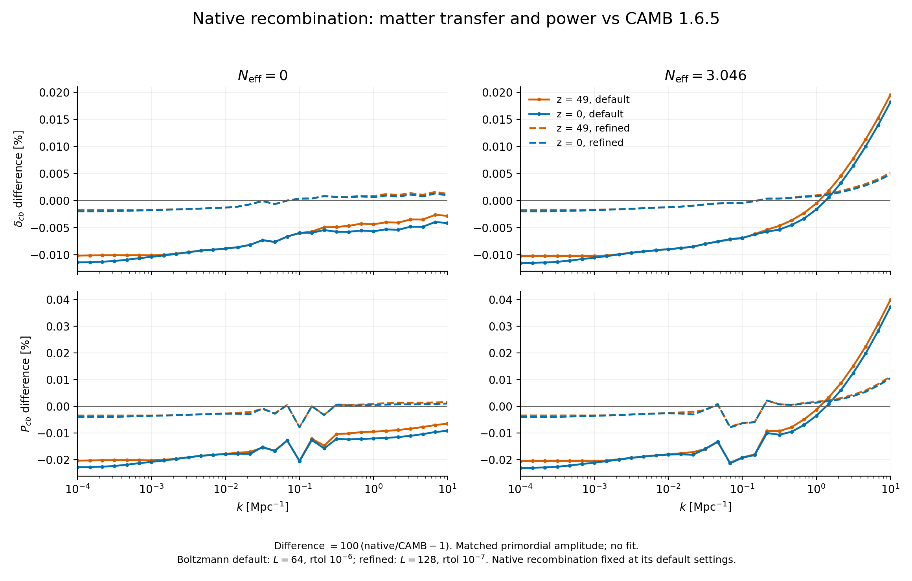

# Native homogeneous recombination

The internal Einstein–Boltzmann initializer obtains its electron fraction,
gas temperature, hydrogen density, and gas pressure from the primordial
chemistry library's `RecombinationHistory`. It no longer launches a RECFAST
process or reads a generated RECFAST table. The bundled Fortran program and
table reader have been removed. Saved RECFAST output remains as regression
data, and offline CAMB comparison tools remain available. Cosmological initial
power is always generated internally; `power.init` and `initial.usePowerFile`
are no longer inputs.

This is a native C++ implementation of the RECFAST 1.5.2 effective-atom
approximation, including its calibration corrections. It does not claim
the accuracy of a new multilevel-atom calculation. Its agreement with
RECFAST and CAMB tests the implementation and numerical integration of
that approximation.

## Chemistry framework and SPH

The new homogeneous model belongs to `primordial_chemistry`. It uses the
existing H/He species normalization and ideal-gas pressure convention.
`chemistryState` converts a history sample into the existing signed-complement
`State` and `Environment`, constructing its energy through the existing
chemistry EOS. Conversion returns `UnsupportedState` outside that EOS's
temperature and density domain, without changing those limits.

The homogeneous solver uses double precision and its own stiff integration.
The SPH solver's float/FloatFloat storage, optically thin reaction network,
thermal limits, and integration controls remain unchanged. Its `atomic6`
and `molecular9` evolution retain their existing behavior. With chemistry enabled,
`chemistry.initialization=recombination` now fills unspecified initial temperature,
H+/H, He+/He, and He++/He from the native history at `cosmology.startRedshift`.
The configured cosmology controls that history. Explicit CLI or INI values override
each field independently; the distributed options and metadata contain the resolved
values. H-, H2, and H2+ keep their existing explicit/default initial values because
the homogeneous history does not model molecules.

Use `chemistry.initialization=manual` for the former fixed defaults (1000 K,
H+/H = 2e-4, neutral helium) or for reproducing older runs. The example INIs
comment out the four optional scalar overrides so the native defaults take effect.
Particle initialization uses the existing SPH EOS and unit conversion, including
its He/H mass convention. Later source integration is unchanged. Restart reads
the stored particle state; it resolves the same initial options only to verify
checkpoint compatibility. Restoring older checkpoints requires the original
initial values, usually with `chemistry.initialization=manual`.

The temperature limits are 10–1e8 K for `atomic6` and 10–6000 K for
`molecular9`, following the subsequent [cold molecular extension](molecular9_cold.md).
An out-of-domain initial temperature fails explicitly and is never raised to a
floor. The fiducial native history at z=49 is 48.855 K and can initialize either
network. An unheated background falls below 10 K near z=20; the supported
initialization range does not imply support for every later epoch.

At a typical starting redshift of 50, cosmological photon escape corrections
primarily matter through the inherited electron abundance and temperature.
The local network still assumes escaping radiation. Dense or irradiated
SPH gas may require shielding and radiation transport; a low redshift
does not establish that it is optically thin.

## Physical model

The background is spatially flat, with baryons, CDM, photons, optional
massless neutrinos, and a cosmological constant. The same supplied radiation
density controls the expansion during recombination and perturbation evolution.
The ionization convention is \(x_e=n_e/n_H\).

Hydrogen uses case-B recombination, inverse photoionization, Lyman-alpha
escape in the expanding background, and the two-photon channel. Helium
includes singlet and triplet recombination, line escape, and neutral-hydrogen
continuum absorption. These follow RECFAST 1.5.2 hydrogen switch 1
and helium switch 6, including their fitted corrections. Early epochs use
fully ionized or Saha-equilibrium branches. The formulas and approximation
are described by [Seager, Sasselov and Scott](https://arxiv.org/html/astro-ph/9912182v2)
and [Wong, Moss and Scott](https://arxiv.org/abs/0711.1357).

Matter temperature evolves with adiabatic cooling and Compton energy
exchange. The integrated thermal variable is \(q=T_m/T_\gamma\), satisfying

\[
\frac{dq}{d\ln a}=-q+\frac{\Gamma_C}{H}(1-q).
\]

This keeps the strongly coupled solution near unity and correctly includes
the changing radiation temperature. The early equilibrium branches take
\(T_m=T_\gamma\), as in RECFAST; in the fiducial model the neglected relative
lag at redshift 3000 is about \(2.5\times10^{-7}\).
See [Scott and Moss](https://arxiv.org/abs/0902.3438).

There is no stellar reionization, molecular network, or feedback heating in
this homogeneous history. Its very low present-day gas temperature describes
an unheated background. The residual-gas calculation retains RECFAST's
extrapolation of its fitted recombination coefficients to low temperatures;
this does not extend the validated temperature domain of the SPH network.
Massive neutrinos remain unimplemented.

## Integration and background coupling

The ODE integration uses the third-order, L-stable Alexander SDIRK method
with damped Newton stages. Each stage evaluates the expansion, density, and
radiation temperature at its own scale factor. Step doubling estimates
the local error by dividing the full-step versus two-half-step difference
by seven; the two-half-step state is accepted. Failed nonlinear solves,
nonfinite intermediate values, and excessive errors reject the step.
Step underflow and exhausted step budgets fail explicitly.

Defaults are relative tolerance \(10^{-7}\), absolute tolerance \(10^{-12}\),
and maximum \(\Delta\ln a=0.01\). The integration stops at Saha-to-ODE
boundaries, and a shape-preserving cubic interpolator supplies intermediate
history samples. Early equilibrium evaluation extends the history to the
perturbation solver's radiation-era start. Later out-of-domain requests fail.

The background adapter uses the native model's proper hydrogen density and
pressure as well as its temperature and electron fraction. This preserves
its helium atomic-mass convention and avoids an inconsistent conversion of
helium mass fraction into electron opacity. The generic independent temperature
integration remains covered by its numerical tests.

## Validation

For the fiducial cosmology with separate \(N_{\rm eff}=0\) and 3.046 runs:

| Maximum relative difference | Electron fraction | Gas temperature |
| --- | ---: | ---: |
| Standalone RECFAST, 1000 output nodes per model | 0.06772% | 0.006632% |
| CAMB 1.6.5, 2151 integer-redshift samples per model | 0.12972% | 0.011427% |

The largest electron differences occur around helium recombination.
Dense fractional-redshift queries expose a 5.36% temperature discrepancy
near \(z=0.26\), reproduced by CAMB's cubic interpolation of its late-time
temperature grid. The raw discrepancy and interpolation check are retained;
the table explicitly uses integer-redshift samples for temperature validation.

Using the native background, the largest individual matter-transfer
differences from CAMB are 0.019708% at default Boltzmann settings and
0.005142% with tolerance \(10^{-7}\) and multipole ceiling 128. Combined
CDM-plus-baryon power differs by at most 0.039862% and 0.011125%,
respectively. These comparisons cover 31 logarithmic wavenumbers from
\(10^{-4}\) to \(10\ {\rm Mpc}^{-1}\), redshifts 49 and 0, and both
neutrino settings, without amplitude fitting.

Refining the chemistry alone changes the dense electron history by at most
\(3.83\times10^{-5}\) relative and temperature by \(7.58\times10^{-8}\).
At fixed perturbation settings, its effect on matter power is below
\(4.16\times10^{-8}\) relative on the separate four-wavenumber probes.

Reproduction commands, parameter settings, comparisons, source hashes, and
the low-redshift CAMB temperature-interpolation investigation are recorded in
[the validation results](native_recombination_results_20261020/README.md).
Both reference models disable reionization and massive neutrinos.

The focused tests cover charge accounting, bounded abundances, helium
recombination ordering, residual ionization, thermal coupling and decoupling,
the helium-free limit, numerical convergence, invalid inputs, conversion
through the existing chemistry EOS, and consistent background pressure
and Thomson opacity. A comparison against frozen RECFAST reference data is
included in CTest; no Fortran compiler or reference executable is needed.
The application smoke tests exercise native internal power generation
without a RECFAST executable in their working directory.

Before removal of the reference executable and the SPH initialization update,
all 19 focused and application CPU tests passed. These include existing
`atomic6` and `molecular9` evolution and exact checkpoint/restart checks.
The 11 existing chemistry and SPH source files match their pre-change
hashes. Direct fast-math compilation and AddressSanitizer/UndefinedBehaviorSanitizer
checks also pass; leak detection was disabled in the sandbox.
Commands, source hashes, executable hashes, and logs are in
[the application checks](native_recombination_results_20261020/application_checks/manifest.json).
